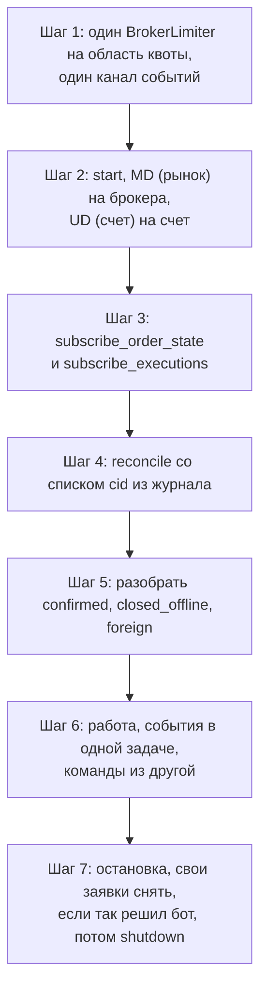

# Контракт для агентов

Все обязательные правила brokapi на одной странице. Страница для ИИ-агента, который пишет код на библиотеке, и для
человека, который этот код проверяет. Нарушение правила не дает ошибки компиляции. Оно дает двойную заявку, торговлю
по чужой картине счета или отказы брокера, поэтому правила строгие.

Для ИИ-агентов: [llms.txt](llms.txt) и [llms-full.txt](llms-full.txt) (вся книга одним файлом).

У каждого правила пять частей: **правило**, **почему**, **что сломается при нарушении**, **как правильно** (код) и
ссылка на подробное объяснение. Код в «как правильно» собирается вместе с библиотекой (`examples/contract.rs`),
поэтому он не отстает от API. Целые рабочие программы лежат в инструкциях: [торговый бот](rust/howto-trading-bot.md),
[несколько брокеров и счетов](rust/howto-infrastructure.md), [исследовательский движок](rust/howto-research.md).

## Порядок любой программы



На схеме: шаги, которые делает любая программа на brokapi, в обязательном порядке. Пункты 3 и 4 нельзя менять местами,
пункт 4 нельзя пропустить: без него любая торговая команда вернет `NotReconciled`.

## Коротко

| № | Правило |
|---|---|
| 1 | `cid` придумывает бот и пишет в журнал на диск до `place` |
| 2 | Торговля только после `reconcile`. Подписка на статусы - до него |
| 3 | `Unknown` не повторять. Выход: `order_state`, `reconcile`. Новая попытка - с новым `cid` |
| 4 | Один `BrokerLimiter` на область, где брокер считает лимит. Ждать квоту должен бот |
| 5 | Свои заявки и сделки идут только `Lossless`. Канал читать всегда, отдельной задачей |
| 6 | `Overflow`, `Reconnected` и `Degraded`: дочитать канал, прочитать состояние, `reconcile`, восстановить пропущенное |
| 7 | `Resync`: стакан выбросить, не торговать по нему |
| 8 | Цены, количества и деньги - `Decimal` (`Price`, `Qty`, `Money`). Цену округлять до шага. Количество в единицах инструмента, не в лотах, кратно лоту |
| 9 | Один UD на счет, один MD на брокера. Идентификатор инструмента - вид своего брокера |
| 10 | `shutdown` не снимает заявки. Снимает или не снимает бот |
| 11 | Чужие заявки (`foreign`) не трогать |
| 12 | Длинную историю свечей читать окнами (`CandlePages`), не одним запросом |
| 13 | Возможность, которой нет у брокера, это `Unsupported`, а не сбой. Проверять до вызова |

## 1. `cid` придумывает бот и пишет в журнал до `place`

**Правило.** Номер заявки (`ClientOrderId`, UUID) создает бот: `ClientOrderId::new_v4()`. Он записывает его в свой
журнал на диск (с принудительной записью, `fsync`) до вызова `place`. Один `cid` - одна заявка. Новая попытка - новый
`cid`.

**Почему.** Библиотека ничего не хранит между запусками. Если ответ на `place` потерялся, `cid` - единственная нить, по
которой после падения можно спросить брокера «что с заявкой». Журнал, записанный после вызова, теряет заявку, когда
процесс падает между вызовом и записью.

**Что сломается.** Без записи до вызова после падения бот не знает о заявке, которая могла встать, и не сверит ее
(`closed_offline` и `confirmed` строятся из вашего списка). Повтор того же `cid` библиотека не отправит:
`Rejected` с кодом `duplicate_place`, единица квоты потрачена.

**Как правильно.**

<div class="lang-tabs">

```rust,ignore
{{#include ../../examples/contract.rs:cid_first}}
```

```python
{{#include ../../crates/python/examples/rules.py:cid_first}}
```

</div>

**Подробнее:** [Круг команд, cid](orders.md#cid-номер-заявки), [Запуск, рестарт и остановка](rust/lifecycle.md).

## 2. Торговля только после `reconcile`

**Правило.** После `start` шлюз торговых команд закрыт. Порядок: подписаться на статусы и исполнения, вызвать
`reconcile(&журнал)`, только потом ставить заявки. Если журнала нет, список пустой: `reconcile(&[])`.

**Почему.** Пока бот не знает, что уже стоит у брокера, новая команда может задвоить заявку или спорить с той, которую
бот не видит. Подписка идет раньше сверки, потому что событие между снимком сверки и подпиской иначе теряется. `subscribe_*` возвращается, когда поток открыт, поэтому заявку можно ставить сразу
после него: исполнение, случившееся после возврата, до бота дойдет. Не открылся за `subscribe_ack_timeout` (3 секунды) -
`Transport`, подписка снята, вызов можно повторить. Исключение Финам: по таймауту `Ok` и поток дооткрывается в фоне (`sub_status`),
подробно в [Круге событий](streams.md#подписка).

**Что сломается.** `place`, `cancel`, `replace`, `place_stop` и `cancel_stop` возвращают `NotReconciled`, в сеть
ничего не уходит. `cid` при этом не потрачен. Если подписаться после заявки, события о ней потеряны.

**Как правильно.**

<div class="lang-tabs">

```rust,ignore
{{#include ../../examples/contract.rs:reconcile_first}}
```

```python
{{#include ../../crates/python/examples/rules.py:reconcile_first}}
```

</div>

`reconcile` только читает, его можно вызывать когда угодно и сколько угодно. Ошибка `reconcile` значит, что сверки
не было и шлюз закрыт: подождать и повторить.

**Подробнее:** [Круг жизни](reconcile.md), [Запуск, рестарт и остановка](rust/lifecycle.md).

## 3. `Unknown` не повторять

**Правило.** Если команда вернула `Error::Unknown` (или `Error::Transport` на команде), заявка могла встать. Команду
не повторять. Спросить брокера по тому же `cid`: `order_state(cid)`, при сомнении `active_orders`, `executions`,
`reconcile`. Новую заявку ставить с новым `cid`, только когда стало ясно, что первой нет.

**Почему.** Из «нет ответа» нельзя понять, дошла ли заявка. Повтор при первой дошедшей дает две заявки на счете, для
денег это худший исход. Библиотека сама никогда не повторяет команды, и бот тоже не должен.

**Что сломается.** Двойная позиция. Отрицательный ответ сразу после обрыва тоже ничего не доказывает: незнакомый номер
приходит как `Rejected` с кодом `not_found` (один код у всех), и запрос,
который был в пути, может дойти позже. Подождать и спросить еще раз.

**Как правильно.**

<div class="lang-tabs">

```rust,ignore
{{#include ../../examples/contract.rs:unknown}}
```

```python
{{#include ../../crates/python/examples/rules.py:unknown}}
```

</div>

Как брокеры отвечают на номер, которого не знают (`order_state`):

| Брокер | Ответ |
|---|---|
| БКС | `Error::Rejected` с кодом `not_found` |
| Т-Банк | `Error::Rejected` с кодом `not_found` |
| Финам | `Error::Rejected` с кодом `not_found` |
| АЛОР | `Error::Rejected` с кодом `not_found` (список заявок дня просматривается, номера, которого нет, брокеру не отправляется: запрос несуществующей заявки он штрафует) |

`Error::Transport` на команде rustdoc описывает как «сбой до отправки», но коннектор не всегда может это доказать, поэтому
считайте, что заявка могла дойти, и спросите `order_state`.

Сколько ждать. Сразу после `Unknown` в том же запуске запрос еще мог быть в пути: спрашивайте несколько секунд, сдавайтесь по
истечении терпения. После **рестарта** (`closed_offline` из сверки) запроса от прежнего процесса уже нет в пути: «не найдена» после короткого ожидания
окончательно, запись в журнале закрывается как «брокер не знает». В примерах
полсекунды для имитаций, для боевого счета берите секунды.

Цикл «спросить, подождать, спросить еще раз» с готовым кодом: [Если что-то пошло не так](rust/recovery.md#place-вернул-unknown).
Для `cancel` с `Unknown` повторить можно после проверки `order_state`. Для `replace` спрашивать по обоим номерам.

**Подробнее:** [Почему нет автоповтора](orders.md#почему-нет-автоповтора), [Ошибки: Unknown](errors.md#unknown).

## 4. Один `BrokerLimiter` на область квоты

**Правило.** Счетчик лимитов (`BrokerLimiter`) создается один на ту область, где брокер считает квоту, и передается всем
коннекторам этой области. Область у брокеров своя.

| Брокер | Область квоты | Счетчиков |
|---|---|---|
| БКС | токен (то есть счет) | по одному на токен |
| Т-Банк | пользователь: все счета и все токены вместе | один на программу |
| Финам | пользователь | один |
| АЛОР | логин (все портфели вместе) | один на логин |

Разные брокеры счетчик не делят.

**Почему.** Два счетчика на одну квоту вместе ее превысят, и брокер начнет отказывать, в самый неудобный момент, в том
числе на отмене. Один счетчик там, где лимиты независимы, лишний: коннекторы будут мешать друг другу.

**Что сломается.** `RateLimited` от брокера на боевом счете. Библиотека сама **не ждет** квоту: при нехватке сразу
`RateLimited { retry_after }`, в сеть ничего не ушло. Ждать должен бот. Квоту тратит **любой** вызов: `find`, `last_trades`,
`trading_params`, подписка, а не только `place` и свечи. Исключение одно: `CandlePages` ждет сам.

**Как правильно.**

```rust,ignore
{{#include ../../examples/contract.rs:one_limiter}}
```

```rust,ignore
{{#include ../../examples/contract.rs:rate_limited}}
```

**Подробнее:** [Лимиты запросов](limits.md), [Несколько счетов и брокеров](rust/accounts.md#таблица-по-брокерам).

## 5. Свои заявки и сделки идут только `Lossless`, канал читать всегда

**Правило.** Статусы своих заявок и свои сделки (`subscribe_order_state`, `subscribe_executions`) приходят только в режиме
`Lossless`: библиотека ставит его сама, размер буфера - `order_state_buffer` в настройке UD (1024). Режим для стакана и
котировок - `Conflate`, для ленты сделок рынка - `DropNewest` или `Lossless`. Канал событий читается всегда, отдельной
задачей, которая ничего не ждет: она только переносит конверты в очередь бота.

**Почему.** Поток брокера нельзя замедлить, и потерянное событие о частичном исполнении значит, что бот торгует по
неверной картине. Поэтому для своих событий дыра не молчит: буфер переполняется громко (см. правило 6).

**Что сломается.** Если задача, которая читает канал, ждет команду или диск (а `place` ждет ответ брокера, до 30 секунд), буфер заполняется. Приходит `Overflow`,
торговля закрывается (`Degraded`). Канал событий делайте с запасом: в примерах книги от 1024 до 8192.

**Как правильно.** Читатель канала переносит конверты в собственную очередь, бот разбирает очередь и может ждать команды
сколько нужно. Очередь без границы: следите за ее длиной, растущая очередь значит, что бот отстает.

```rust,ignore
{{#include ../../examples/contract.rs:read_the_channel}}
```

Подписка на стакан:

```rust,ignore
{{#include ../../examples/contract.rs:book_subscription}}
```

**Подробнее:** [Круг событий](streams.md#режимы-буфера).

## 6. `Overflow`, `Reconnected` и `Degraded`: дочитать, сверить, восстановить

**Правило.** Пришел `Event::Overflow` или `Event::Reconnected` (поток своих заявок или исполнений оборвался и открыт снова) или команда вернула `Error::Degraded`. По порядку: дочитать канал до пустого
(это история до дыры), вызвать `reconcile(&журнал)`, восстановить пропущенное из снимков (состояния из `confirmed` и
`order_state`, сделки из `executions(range)` начиная с `lost_from` (у `Reconnected` с запасом раньше `gap_from`), портфель из `portfolio()`), вернуться к работе.
Для **рыночной** подписки сверки нет: подписку снять (`unsubscribe`) и оформить заново.

**Почему.** Торговать при дыре в данных о своих заявках нельзя: бот мог пропустить исполнение или снятие. Шлюз закрыт, пока
бот не сверит картину со счетом.

**Что сломается.** Без сверки каждая торговая команда возвращает `Degraded`. Если сверку сделать до того, как дочитан
канал, события до дыры будут обработаны уже после снимка и могут откатить состояние назад.

**Как правильно.**

```rust,ignore
{{#include ../../examples/contract.rs:overflow}}
```

**Подробнее:** [Если что-то пошло не так](rust/recovery.md#пришел-overflow-или-ошибка-degraded),
[Круг событий](streams.md#переполнение-overflow-и-degraded),
[`Reconnected`](streams.md#reconnected-поток-заявок-или-исполнений-оборвался).

## 7. `Resync`: стакан выбросить

**Правило.** `Event::Resync { instrument, .. }` значит, что хранимому стакану этого инструмента верить нельзя. Выбросить его,
не торговать по нему, дождаться следующего `Event::OrderBook`.

**Почему.** После обрыва поток переоткрыт, часть данных могла пропасть. Стакан у всех брокеров приходит полным снимком,
поэтому следующий снимок сам все исправит.

**Что сломается.** Заявка по цене из устаревшего стакана.

**Как правильно.**

```rust,ignore
{{#include ../../examples/contract.rs:resync}}
```

Обрыв потока стакана бот видит как `Resync`. Обрыв потока своих заявок или исполнений приходит как `Event::Reconnected`:
шлюз при этом закрыт (`Degraded`), см. правило 6.

**Подробнее:** [Круг событий](streams.md#resync-стакан-мог-потерять-данные).

## 8. Цены и количества - `Decimal`, цена на шаге

**Правило.** `Price`, `Qty` и `Money` построены на `Decimal`. `f64` для денег, цен и количеств не использовать нигде.
Цену округлять до шага цены инструмента (`TradingParams::price_step`): покупка вниз (`RoundMode::Down`), продажа вверх.
Шаг и лот передать коннектору один раз: `price_grid().learn(&params)`. Количество заявки - в **единицах инструмента**
(штуки, контракты, единицы валюты), одинаково у всех брокеров, и кратно лоту (`TradingParams::lot_size`). Некратное,
дробное там, где брокер берет целые, и нулевое количество это `Rejected` с кодом `invalid_qty` до отправки. Ничего не
округляется. Т-Банк считает лотами, и его коннектор переводит туда и обратно сам.

**Почему.** `244.3` в двоичной дроби не лежит ровно, цена «не на шаге» получается из-за шума и биржа отклоняет заявку.

**Что сломается.** Цена не на шаге дает `Rejected` с кодом `price_off_step` до отправки (квота и `cid` не тратятся), если
шаг коннектору известен. Если не известен, решает брокер, и отказ придет от него. Количество, которое не целое число
лотов, дает `invalid_qty` без отправки (у Т-Банка и АЛОРа всегда, у БКС и Финама когда лот передан).

**Как правильно.**

```rust,ignore
{{#include ../../examples/contract.rs:decimal}}
```

```rust,ignore
{{#include ../../examples/contract.rs:price_grid}}
```

**Подробнее:** [Деньги, цены и количества](numbers.md).

## 9. Один UD на счет, один MD на брокера, идентификатор своего брокера

**Правило.** Заявки и портфель идут через UD, по одному на счет. Рынок идет через MD, по одному на брокера. `InstrumentId`
несет `NativeId`, и вид у каждого брокера свой (БКС: тикер и класс, Т-Банк: `uid`, он основной, но принимаются figi и тикер с классом, Финам: символ `SBER@MISX`). Получать
идентификатор через `find` или собирать по странице брокера.

**Почему.** MD и UD разделены, чтобы всплеск стакана не задерживал отмену заявки. Один UD не умеет работать с двумя счетами.

**Что сломается.** Идентификатор чужого вида дает `Error::Config`, вызов не делается. Общий портфель по счетам и выбор
счета для заявки в библиотеке нет, это слой бота.

**Подробнее:** [Несколько счетов и брокеров](rust/accounts.md), [Брокеры](brokers/README.md).

## 10. `shutdown` не снимает заявки

**Правило.** `shutdown(режим)` останавливает коннектор и забирает его по значению. Заявки на бирже он не трогает. Хочет бот
снять свои заявки перед выходом, снимает их сам и до `shutdown`. Порядок: сначала UD (команды закрыты), потом MD.

**Почему.** «Снять все» может быть неверным решением: например, защитный стоп должен пережить бота.

**Что сломается.** Заявка, которую бот считал снятой, остается на бирже и после рестарта приходит в `confirmed` сверки.

**Как правильно.**

```rust,ignore
{{#include ../../examples/contract.rs:stop}}
```

**Подробнее:** [Запуск, рестарт и остановка](rust/lifecycle.md#остановка).

## 11. Чужие заявки не трогать

**Правило.** Заявки из списка `foreign` (поставлены руками, из приложения или другим роботом) не снимать и не менять. Показать
человеку.

**Почему.** Бот не знает, зачем человек их поставил. Снятие может сломать чужую стратегию или защитный стоп.

**Что сломается.** Чужая позиция остается без защиты. Библиотека такие заявки сама не трогает и не прячет.

**Как правильно.**

```rust,ignore
{{#include ../../examples/contract.rs:foreign}}
```

**Подробнее:** [Круг жизни](reconcile.md#что-бот-передает-и-что-получает).

## 12. Длинную историю свечей читать окнами

**Правило.** Брокер ограничивает один запрос свечей по числу баров или длине периода (БКС: 1440 баров, Т-Банк: от дня для
минутных до десяти лет для месячных). Историю длиннее читать через `CandlePages` или `load_candles`: они режут период на окна,
ждут `RateLimited`, повторяют чтение после сбоя сети, склеивают окна без дублей и помнят, откуда продолжить.

**Почему.** Запрос длиннее предела брокер отклоняет. Ручная нарезка забывает про лимит запросов и про бары на краю окна.

**Что сломается.** `Rejected` на слишком длинном периоде, дубли баров на стыках окон, `RateLimited` посреди выгрузки без
места, откуда продолжить.

**Как правильно.**

```rust,ignore
{{#include ../../examples/contract.rs:history}}
```

Повторяются только чтения. Команды не повторяются нигде в библиотеке.

Как вести себя после `HistoryError`: смотрите `error.class()`. `Retryable` (лимит, сеть): подождать (`retry_after` у `RateLimited`) и
начать снова с `resume_from` или с места, где кончается файл, не больше нескольких попыток. `Fatal` (`Rejected`, `Config`,
`Unsupported`): то же чтение упадет снова, бумагу записать в отчет и идти к следующей.

**Подробнее:** [Как собрать исследовательский движок](rust/howto-research.md).

## 13. `Unsupported` - не сбой

**Правило.** Возможность, которой нет у брокера, возвращает `Error::Unsupported { capability }` сразу, без сети. Это не сбой:
убрать вызов или проверить `caps()` заранее. Библиотека отсутствующий метод опросом не подменяет. Примеры: `replace` у Финама,
свечи 10 минут у БКС, поток стоп-заявок у всех.

**Почему.** Подмена (отмена и новая заявка вместо `replace`) не атомарна: старая заявка может исполниться между шагами. Решение
за ботом.

**Что сломается.** Бот, который считает `Unsupported` сбоем и повторяет, зациклится.

**Подробнее:** [События и возможности](events.md#возможности-коннектора-caps).

## Чего библиотека не делает

Это не недоработки. Это слой над коннекторами, его пишет бот:

| Что | Чей слой |
|---|---|
| Стратегии, сигналы, управление риском | бот |
| Учет позиций, общий портфель по счетам, выбор счета для заявки | бот |
| Журнал заявок на диске, восстановление состояния после рестарта | бот (библиотека дает `cid` в каждом событии и сверку) |
| Бэктест и подмена времени | нет. Для проверки кода есть имитации [brokapi-mocks](rust/mocks.md), для данных - запись и воспроизведение событий ([исследовательский движок](rust/howto-research.md)) |
| Автоповтор команд | нет и не будет |
| Снятие заявок при остановке | бот |
| Работа с чужими заявками | человек |
| Хранение токенов | бот (`.env`, в логи не попадают) |

## Частые ошибки агентов

Что агент обычно делает не так, когда пишет бота без чтения этой страницы, и как правильно.

| Ошибка | Что будет | Как правильно |
|---|---|---|
| Ставит заявку в цикле повторов «пока не получится» | Две заявки после первого `Unknown`. Для того же `cid` - `duplicate_place` | Исходы разные: `Rejected` - исправить причину и новый `cid`, `RateLimited` - подождать, `Unknown` - `order_state`. Правило 3 |
| Считает `Ok(OrderAck)` исполнением | Бот думает, что позиция открыта, а заявка только стоит | `OrderAck` значит «брокер принял». Исполнение приходит событиями `Event::Order` и `Event::Execution` |
| Ставит заявку сразу после `start` | `NotReconciled` | Подписка, `reconcile`, потом торговля. Правило 2 |
| Подписывается на статусы после `place` или после `reconcile` | События между снимком и подпиской потеряны | Подписка раньше сверки и раньше первой заявки |
| Новый `BrokerLimiter` для каждого коннектора | Вместе превышают квоту брокера | Один на область квоты. Правило 4 |
| Придумывает `cid` внутри повтора или использует `cid` из журнала повторно | `duplicate_place` | Новая попытка - новый `cid`, старый `cid` остается в журнале как финальный |
| Использует `f64` для цены | Цена не на шаге, округление уезжает на копейку | `Price`, `Decimal`, `round_to_step`. Правило 8 |
| Ждет внутри цикла чтения канала ответ на команду | Канал переполняется, торговля закрывается (`Degraded`) | Команды из другой задачи, чтение канала короткое. Правило 5 |
| Хранит стакан и не смотрит на `Resync` | Торговля по устаревшему стакану | Выбросить стакан. Правило 7 |
| Не обрабатывает `Overflow` | После него каждая команда - `Degraded` | Правило 6 |
| Считает сообщение `Rejected` кодом | Ломается при смене формулировки брокера | Сравнивать `code`, не `message` |
| Считает `not_found` после `Unknown` окончательным | Ставит вторую заявку, пока первая в пути | Подождать и спросить еще раз. Правило 3 |
| Ждет, что `shutdown` снимет заявки | Заявки остаются на бирже | Снять самому до `shutdown`. Правило 10 |
| Снимает все заявки счета «для чистоты» | Снимает чужие защитные стопы | Только свои, из журнала. Правило 11 |
| Отправляет период в год одним `candles` | `Rejected` по длине периода | `CandlePages`. Правило 12 |
| Не запоминает шаг цены | Отказ придет от брокера, а не до отправки | `price_grid().learn(&params)` |
| Количество не кратно лоту, дробное или нулевое | `invalid_qty` до отправки | Количество в единицах инструмента, кратно лоту. [Деньги, цены и количества](numbers.md#количество-единицы-инструмента-не-лоты) |
| Берет идентификатор инструмента от другого брокера | `Config` | `find` у MD своего брокера |
| Подключает крейт без флага брокера | Нет `brokapi::bcs` | `features = ["bcs"]` и другие. [Быстрый старт](rust/quickstart.md) |
| Запускает `#[tokio::main(flavor = "current_thread")]` с блокирующим кодом | Зависания | Обычный многопоточный `tokio`, блокирующее - в `spawn_blocking` |
| Пишет в журнал после `place` | Падение между вызовом и записью теряет заявку | До вызова, с `fsync`. Правило 1 |
| Ставит заявки через `raw()` | Заявка не попадает ни в события, ни в `reconcile`, коннектор за ней не следит | Заявки только через `OrderExecutor`. [raw](rust/raw.md) |

## Перед запуском на настоящем счете

Прочитайте [Перед боевым счетом](before-live.md) и список допущений по документации брокеров: [agents/unverified.md](https://brokapi.ru/docs/agents/unverified.md). Кроме них:

1. Пройти тесты против имитаций ([Как тестировать](rust/mocks.md)): путь `Unknown`, `Overflow`, рестарт со сверкой.
2. Токены только в `.env`, в журнал и логи не попадают.
