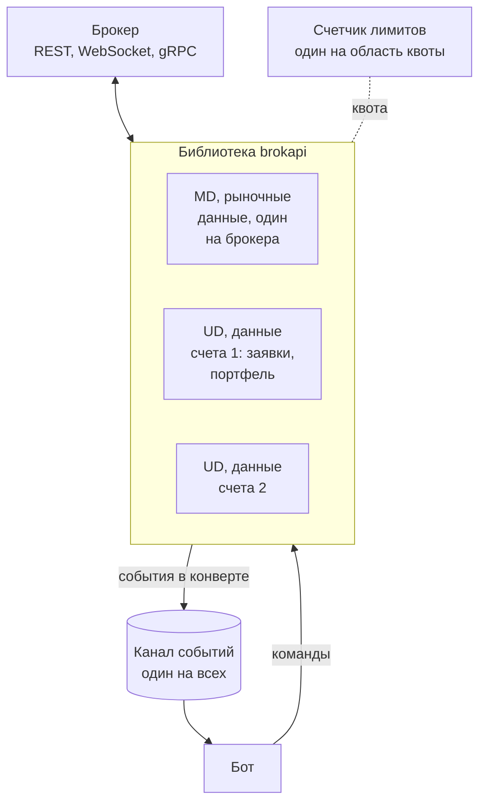
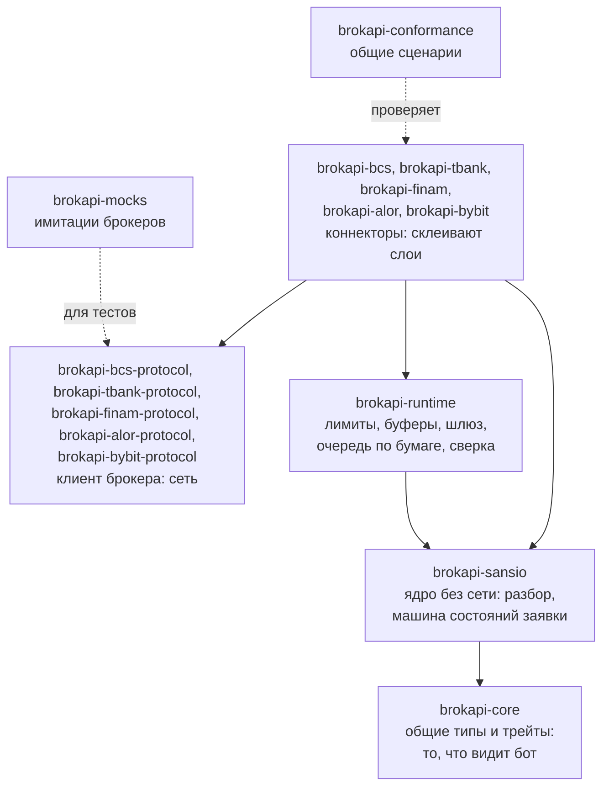
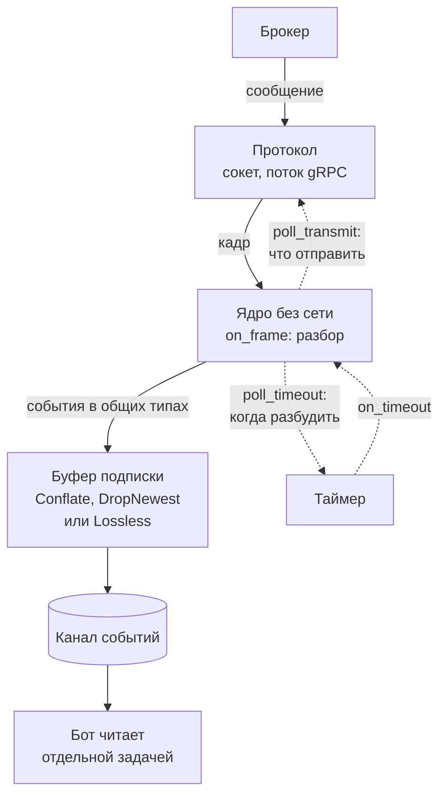
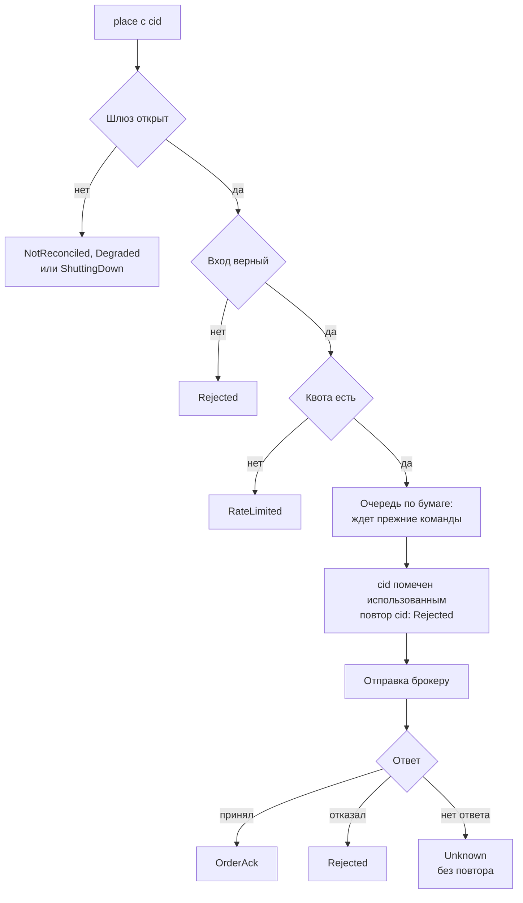
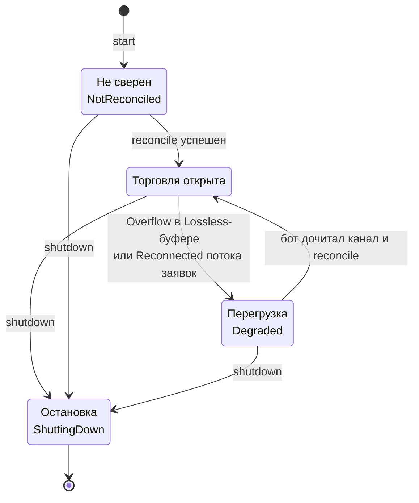

# Карта: сущности и три круга

Эта страница - карта библиотеки: из чего она состоит, по каким кругам ходят данные и команды и на каких правилах это
держится. Подробности каждого круга лежат на своей странице, здесь только то, что нужно, чтобы не потеряться.
Термины в таблице ниже - словарь всей книги: везде они значат ровно это.

## Сущности и связи

Бот сам поднимает коннекторы, глобального реестра в библиотеке нет. Коннекторов два вида: **MD** - рынок, один на
брокера, и **UD** - заявки и портфель, один на счет. Все пишут в один канал событий. Запускаются они одинаково:
`start(конфиг, счетчик_лимитов, канал_событий)`.

На схеме: бот, библиотека с коннекторами, брокер, общий канал событий и счетчик лимитов.

Из схемы следует три вещи, и у каждой есть причина:

- **MD и UD разделены.** Всплеск в потоке стакана не должен задерживать отмену заявки. Если бы команды и стакан шли
  через одно соединение, отмена стояла бы в очереди за стаканом. У MD и UD разные соединения и разные лимиты, они
  ничего не знают друг о друге и не делят сокет.
- **Счетчик лимитов один на ту область, где брокер считает квоту.** У Т-Банка это пользователь (все счета вместе),
  у БКС - токен, то есть счет (по документации). Дать двум коннекторам разные счетчики
  на одну квоту нельзя: вместе они превысят ее, и брокер начнет отказывать. Дать один счетчик там, где лимиты
  независимы, тоже плохо: коннекторы будут мешать друг другу без нужды. Как устроен счетчик: [Лимиты запросов](limits.md),
  какая область у какого брокера: [Несколько счетов и брокеров](rust/accounts.md).
- **Канал событий один, коннектор не знает, кто его читает.** Бот отдал канал при старте и может дать один всем
  коннекторам или по каналу каждому. Если читатель отстает, коннектор не блокируется: что тогда происходит,
  решает буфер подписки ([Круг событий](streams.md)).

Словарь:

| Сущность | Что это |
|---|---|
| Коннектор MD | стаканы, сделки рынка, котировки, свечи. К счету не привязан |
| Коннектор UD | заявки, свои сделки, портфель. Ровно один счет |
| Счетчик лимитов | набор «ведер» с квотой. Считает запросы до отправки, при нехватке сразу `RateLimited`, в сеть ничего не уходит ([Лимиты запросов](limits.md)) |
| Канал событий | очередь `mpsc`, которую бот отдал при старте |
| Конверт `Envelope` | событие плюс метка коннектора `source`, номер подписки `sub` и время ([События и возможности](events.md)) |
| `cid` | номер заявки. Придумывает бот, UUID, до отправки ([Круг команд](orders.md#cid-номер-заявки)) |
| Подписка | поток событий одного вида. У каждой свой буфер ([Круг событий](streams.md)) |
| Шлюз команд | замок на торговые команды (`CommandGate`): закрыт после старта, при перегрузке и при остановке ([Круг жизни](reconcile.md)) |
| Сверка | `reconcile`: сравнение списка заявок бота со счетом, после нее шлюз открывается ([Круг жизни](reconcile.md)) |

## Слои

Крейты разложены так, чтобы логика брокера не знала про сеть, а сеть - про логику. Стрелка на схеме значит
«пользуется». Что лежит в каждом крейте, до отдельного типа: [Справочник API](api.md).

Что из этого следует:

- Бот видит только `brokapi-core`. Сменить брокера - поменять коннектор, код бота почти не меняется.
- Ядро без сети проверяется записанными сообщениями брокера и виртуальным временем, быстро и без интернета.
- Внизу - тестовый контур: имитация брокера с настоящим протоколом и общие сценарии, которые гоняются против
  каждого коннектора.

### Зачем ядро без сети

Ядро коннектора (sans-io) - чистая логика: «пришло такое сообщение брокера -> вот события для бота» и «чтобы
подписаться, нужно отправить вот такое сообщение». Оно **не открывает сокеты, не держит таймеры, не знает про
асинхронность**. Сеть и время ему подает внешний слой. Интерфейс ядра (`BrokerCore`) - пять действий:
`on_frame` (разобрать пришедшее сообщение), `poll_transmit` (что отправить брокеру), `poll_timeout` (когда
разбудить ядро), `on_timeout` (обработать наступивший срок), `apply` (привести подписки к нужному набору).

Зачем так:

- Ядро проверяется быстро и без сети. Тест кормит его записанными сообщениями брокера и проверяет события. Время
  в таких тестах виртуальное.
- Ошибки разбора и перевода ищутся отдельно от ошибок сети. Если смешать, сбой в сети похож на ошибку разбора, и
  причину ищут не там.
- Записанные настоящие сообщения (когда будут живые прогоны) становятся тестами без правок.

У Т-Банка и Финама запросы типизированы (gRPC), поэтому вместо `poll_transmit` у ядра Т-Банка есть свой метод
выдачи запросов. На работу бота это не влияет.

## Три круга

Вся работа - три круга, которые крутятся одновременно и почти не мешают друг другу: **события** (брокер -> бот),
**команды** (бот -> брокер) и **жизнь коннектора** (шлюз команд и сверка). Бот общается с коннекторами двумя
путями: команды - вызовы методов, ответ приходит как результат вызова, события - все подписки всех коннекторов
складываются в один канал.

### Круг событий: брокер -> бот

Внутри коннектора сообщение брокера проходит три ступени. Ядро только разбирает и подсказывает, что отправить и
когда его разбудить, а сокеты и таймеры держит внешний слой. На схеме: путь сообщения от брокера до бота и
служебные сигналы ядра.

Поток брокера читается всегда и никогда не ждет бота. Если бот отстает, решает режим буфера:

- `Conflate` - старый снимок заменяется свежим. Для стакана и котировок.
- `DropNewest` - лишнее отбрасывается со счетчиком. Для некритичного.
- `Lossless` - ничего не теряется. Для своих заявок и сделок. Переполнился - `Overflow` и закрытый шлюз. Оборвался и открылся заново поток заявок или исполнений - `Reconnected` и тоже закрытый шлюз
  (круг жизни ниже).

Почему режимов три: стакану нужен только последний снимок, а своим сделкам нужны все, и один режим на все
подписки либо потерял бы деньги, либо копил бы устаревший стакан. Подробно, с обрывами и восстановлением
соединений: [Круг событий](streams.md).

### Круг команд: бот -> брокер

Команда проходит три проверки без сети, и только потом уходит к брокеру. На схеме: путь `place` и все его
исходы.

Что из этого следует:

- Все, что выше «Отправки», до брокера не доходит. Заявки точно нет, а при отказе на первых трех проверках `cid`
  не потрачен: после устранения причины его можно использовать снова. `cid` помечается только после очереди,
  поэтому пока вызов ждет в очереди, номер еще чистый.
- `Unknown` не повторяется никогда. Заявка без ответа могла встать, повтор дал бы **две заявки**. Бот выясняет
  судьбу через `order_state(cid)`: [Если что-то пошло не так](rust/recovery.md#place-вернул-unknown).
- Очередь по бумаге: отмена не обгонит постановку той же бумаги. Разные бумаги идут параллельно. Отмена тратит
  отдельное ведро квоты, поэтому поток постановок ее не вытесняет ([Лимиты запросов](limits.md)).

Исходы, коды отказов и порядок проверок подробно: [Круг команд](orders.md).

### Круг жизни: шлюз торговли

У каждого UD есть шлюз торговых команд. Чтение и подписки работают всегда, закрывается только торговля. На
схеме: три состояния шлюза и переходы между ними.

Из обоих закрытых состояний выход один - сверка. Это и есть ответ на вопрос «можно ли торговать»: только когда
список заявок бота совпал со счетом и в данных о своих заявках нет дыры. Остановка необратима: коннектор
закрывается, торговать дальше нельзя.

Сверка, ее результат и причины порядка действий: [Круг жизни](reconcile.md). Что делать по шагам: [Запуск,
рестарт и остановка бота](rust/lifecycle.md).
