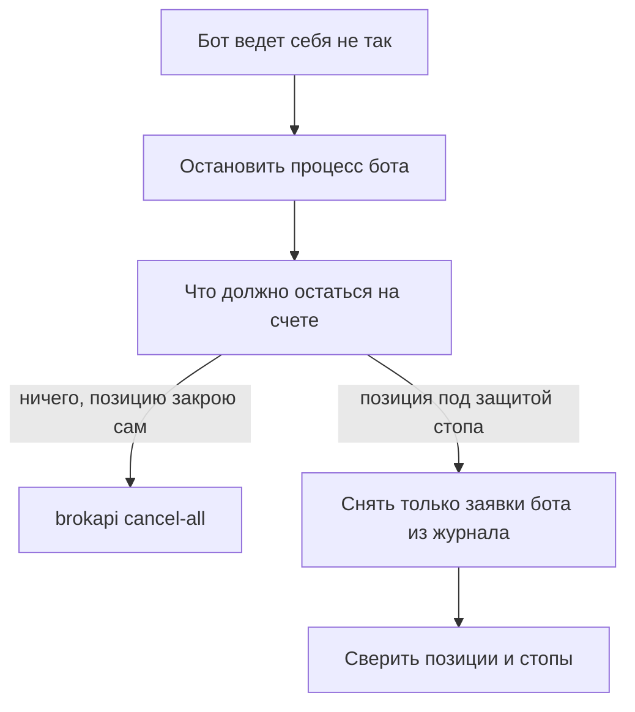

# Аварийная остановка бота

Инструкция. Цель: остановить бота, который ведет себя не так, и твердо знать, что при этом останется на счете. Заранее, до первой боевой заявки, решите,
какой из путей ниже ваш, и проверьте его на имитации или песочнице.

Главное, что надо знать: **остановка бота заявок на бирже не снимает.** Заявка живет у брокера дольше, чем процесс, который ее поставил. Стоп-заявки
тоже остаются. Позицию не закрывает ничто из того, что описано здесь.

## Что остается на счете после каждого действия

| Действие | Заявки | Стоп-заявки | Позиция |
|---|---|---|---|
| Остановка процесса бота (`Ctrl+C`, `kill`, падение) | остаются | остаются | остается |
| `client.close()` в Python, `shutdown` в Rust | остаются | остаются | остается |
| `brokapi stop <гейтвей>`, `brokapi down` | остаются | остаются | остается |
| `brokapi stop <гейтвей> --cancel-orders` | снимаются все | снимаются все, **и защитные тоже** | остается |
| `brokapi cancel-all <гейтвей>` | снимаются все | снимаются все, **и защитные тоже** | остается |
| Скрипт «снять заявки бота» (ниже) | снимаются заявки из журнала бота | остаются | остается |



На схеме: сначала всегда останавливают бота, чтобы он не ставил новые заявки, а потом выбирают, снимать ли все подряд или только заявки бота. От выбора зависит,
останется ли позиция защищенной.

## Что делает `close()`

`await client.close()` останавливает два коннектора клиента (рыночных данных и счета), дает им до `deadline` секунд закончить дела (по умолчанию 5, `None` - сразу)
и завершает поток событий. Он безопасен при повторном вызове и возвращает отчеты коннекторов. **Заявки на бирже он не снимает**, как и `shutdown` в Rust
([Контракт для агентов, правило 10](agent-contract.md#10-shutdown-не-снимает-заявки)). Если бот должен уйти, не оставив заявок, он снимает их сам до `close()`.

У клиента, подключенного через гейтвей, `close()` только закрывает его соединение. Гейтвей продолжает работать, заявки и стопы остаются, подписки этого бота
гейтвей отпускает сам, когда бот долго не появляется.

## `brokapi cancel-all`

```bash
brokapi cancel-all <гейтвей>
```

> **Команда снимает все активные заявки и все стоп-заявки счета. В том числе защитные стопы вашего бота и чужие заявки, поставленные руками или другой программой.**
> После нее открытая позиция остается без стопа, а заявки, о которых вы не знали, исчезают.

Это аварийная кнопка на случай, когда важнее всего очистить счет, а позицию вы защитите или закроете сами. Гейтвей при этом продолжает работать. Команда заявок не ставит.
На отказ по лимиту она ждет и повторяет, пока не снимет. Нужен запущенный гейтвей ([Команды brokapi](gateway/commands.md), [Запуск и обслуживание](gateway/operations.md#остановить-гейтвей-и-снять-заявки)).
Ту же работу с остановкой гейтвея делает `brokapi stop <гейтвей> --cancel-orders`.

Прежде чем запускать, посмотрите, что будет снято:

```bash
brokapi orders <гейтвей>    # активные заявки счета
brokapi stops <гейтвей>     # активные стоп-заявки счета
```

Агент запускает `cancel-all` только со слова человека: команда меняет настоящий счет, и защитные стопы после нее придется ставить заново.

## Снять заявки бота и оставить позицию защищенной

Нужен список `cid` бота, то есть его журнал ([Контракт, правило 1](agent-contract.md#1-cid-придумывает-бот-и-пишет-в-журнал-до-place)). Скрипт открывает клиента, сверяется с
журналом и снимает только то, что в журнале, живое и найдено у брокера. Стопы он не трогает, чужие заявки (`foreign`) тоже.

```python
{{#include ../../crates/python/examples/emergency_stop.py:cancel_own}}
```

Что здесь важно:

- `reconcile` нужен и скрипту: в новом процессе шлюз торговых команд закрыт, и `cancel` без него вернет `NotReconciled`.
- Заявки в `confirmed` взяты из вашего журнала. Заявки в `foreign` (их нет в журнале) скрипт не снимает: это решение человека.
- `Rejected` на `cancel` значит «брокер такой заявки не знает»: она уже исполнилась или снята. Что именно, скажет `order_state(cid)`.
- `Unknown` и `Transport` на `cancel` значат, что исход неясен. Повторять вслепую не нужно: спросите `order_state(cid)`. Скрипт возвращает такие `cid` списком.
- За время работы скрипта заявка могла частично исполниться. Позиция тогда выросла, а стоп остался прежним по размеру.

После снятия сверьте позиции и стопы и, если стопа не хватает, поставьте недостающий: [Бот со стопом: старт и рестарт](python/stop-orders.md#бот-со-стопом-старт-и-рестарт).
Тот же рецепт делает бот при каждом запуске, поэтому после аварии достаточно запустить его заново.

Скрипт идет в паре с остановкой самого бота. В Rust порядок тот же ([Запуск, рестарт и остановка](rust/lifecycle.md)): остановить поток решений, снять свои заявки по
журналу, `shutdown`, и только потом процесс.

## Что делает человек

Бот и скрипт позицию не закрывают. Если позицию надо закрыть, это делается в приложении или кабинете брокера: библиотека для этого не предназначена, а команды `brokapi`
заявок не ставят ([Команды brokapi](gateway/commands.md)).

## Как проверить

Скрипт «снять заявки бота» проверен на имитациях всех четырех брокеров: две заявки бота и одна чужая стоят вместе с защитным стопом, бот закрывается, скрипт
в новом процессе снимает две, чужая и стоп остаются. Потерянный ответ на `cancel` попадает в список неясных. Для этих тестов нужен клон репозитория (в пакете `pip`
тестов и примеров нет):

```bash
git clone https://github.com/runinfra/brokapi && cd brokapi
pip install brokapi pytest pytest-asyncio
cd crates/python && pytest tests/test_guides.py -k emergency
```

Свой путь остановки проверьте так же: поставьте заявку и стоп на имитации или песочнице, остановите бота выбранным способом и посмотрите `active_orders()`
и `active_stop_orders()` (или `brokapi orders` и `brokapi stops`).
