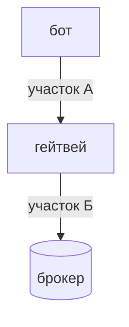

# Чем гейтвей отличается от прямого подключения

Объяснение для тех, кто уже пишет ботов на библиотеке и переносит бота на гейтвей. Правила те же: `cid` придумывает бот, команда без ответа
не повторяется, торговля после сверки ([три правила](../README.md#три-правила-на-которых-все-держится)). Клиент `RemoteClient` умеет те же трейты
ядра (`OrderExecutor`, `OrderBookSource`, `PortfolioSource` и остальные), поэтому код бота почти не меняется. Меняется дорога: между ботом и брокером
появился еще один процесс. Из-за этого есть отличия, и каждое объяснено.

Схема показывает, откуда берутся отличия. Ответ на команду может потеряться на каждом из двух участков дороги. В библиотеке дорога одна, участок Б.

Потерялся ответ на участке Б: гейтвей не знает, дошла ли команда до брокера, и бот получает `Unknown`. Потерялся на участке А: не знает уже бот, а гейтвей
мог команду выполнить. Поэтому `Unknown` приходит и в этом случае, а клиент не повторяет команду ни на одном из участков.

| Что | В библиотеке | Через гейтвей | Почему |
|---|---|---|---|
| Ответ на команду потерян | `Unknown`, если потерян ответ брокера | `Unknown` и тогда, когда потерян ответ гейтвея: оборвалась связь с ним или вышел срок. Клиент не повторяет команду | Гейтвей мог ее выполнить. Повтор дал бы вторую заявку. Что делать: [Если что-то пошло не так](../rust/recovery.md) |
| Бот перестал ждать | Решает код бота | Команда на гейтвее выполняется до конца, даже если вызов бросили | Иначе отмена вызова оставила бы неизвестное состояние: заявка ушла к брокеру или нет |
| Журнал заявок | Ведет бот | Гейтвей ведет еще и свой журнал `cid` на диске | Чтобы после его перезапуска сверить заявки с брокером до приема команд. Свой журнал бот все равно ведет: сверка бота идет по его списку |
| События | Канал `mpsc`, `Resync` и `Overflow` | Поток `Events` с номерами, кадры `Gap` и `Lagged` | Между гейтвеем и ботом событие может потеряться, а нумерация и кольцо позволяют это заметить и догнать. Подробно: [События](events.md) |
| Подписки | Подписка принадлежит боту | Подписку открывает бот, но события подписки получают все боты, которые читают поток, а владельцев у подписки может быть несколько | Подписка стоит квоты у брокера, поэтому одинаковые подписки склеиваются. Фильтр `own_orders_only` оставляет в потоке только события ваших заявок |
| Лимиты | Счетчик в процессе бота | Один счетчик на гейтвей, общий для его ботов, очереди между ботами нет | Лимит брокера один на счет, а не на бота |
| Сверка бота | `reconcile(ledger)` сверяет ваш список с брокером | То же, но заявки других ботов этого гейтвея возвращаются как `foreign`. Флаг `include_journal` в запросе добавляет к вашему списку журнал гейтвея (клиент Rust его не выставляет, из других языков он доступен) | Гейтвей видит заявки всех своих ботов, бот - только свои |
| Старт | Бот сам открывает соединение | Гейтвей мог еще не закончить сверку: вызовы получают `UNAVAILABLE` с причиной `GATEWAY_STARTING`, команда точно не выполнялась | Пока журнал не сверен, принимать заявки нельзя. Ждать готовности: вызов `Health` |
| Остановка | `shutdown` не снимает заявки на бирже | Остановка гейтвея заявки тоже не трогает. Снять их: `brokapi stop <гейтвей> --cancel-orders` или `brokapi cancel-all` | Заявка на бирже переживает процесс, и это правильно: она может быть частью стратегии |
| Первый снимок портфеля БКС | Подписка на портфель присылает снимок | Подписка на портфель БКС присылает только изменения: гейтвей сверяется на старте, и первый снимок до подписки уже прошел. Начальное состояние бот читает вызовом `Portfolio` | Так ведет себя коннектор БКС при открытии сокета портфеля |
| Доступ | Токен брокера в процессе бота | Токен брокера только у гейтвея. Боту нужен ключ `access.key` и имя | Боты не видят токена брокера. Ключ дает доступ только к гейтвею и только с этой машины |

## Что не меняется

- Номер заявки бот придумывает сам и записывает до отправки.
- Ошибки те же: `Rejected`, `RateLimited`, `Unsupported`, `NotReconciled`, `Degraded`, `Unknown`. Гейтвей добавляет две причины отказа,
  при которых команда точно не выполнялась: `GATEWAY_STARTING` и `BAD_REQUEST`. Все: [Ошибки и что с ними делать](../errors.md) и [таблица в «Подключить бота»](bots.md#ошибки).
- Деньги и цены - десятичные числа, на проводе строками.
- Любой метод брокера доступен через `Raw`: имя метода и аргументы в JSON.

## Чего гейтвей пока не делает

- **Очередь между ботами по кругу.** Лимитер отказывает сразу, очереди ожидания в нем нет: гейтвей не держит чужую команду и не меняет поведение «команда
  не ждет». Один бот может занять квоту целиком, остальные получат `RateLimited`.
- **Доступ с других машин и шифрование.** Только этот компьютер.
