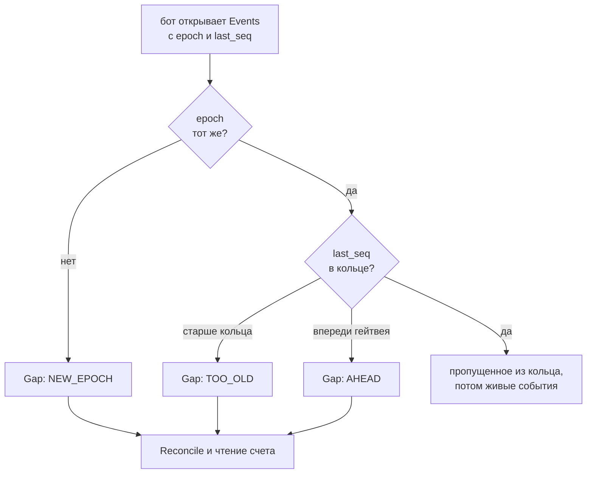

# События и сверка после перезапуска

Объяснение: как гейтвей отдает боту события, как бот догоняет пропущенное после обрыва и что он обязан сделать, если догнать нельзя. Если вы пишете
бота, прочитайте страницу целиком: на ней весь порядок действий после сбоя. Как подключиться и в каком порядке вызывать: [Подключить бота](bots.md).

## Что приходит в потоке

Бот открывает вызов `Events` и читает кадры четырех видов:

| Кадр | Что значит |
|---|---|
| `Ready` | Всегда первый. Поток зарегистрирован в гейтвее: все, что происходит после него, уже предназначено этому боту. Несет `epoch`, номер следующего события и число событий, которые сейчас придут из кольца |
| `Event` | Событие: заявка, исполнение, стакан, портфель и так далее, как у коннектора. У каждого есть номер `seq`, он растет на единицу |
| `Gap` | Пропущенное вернуть нельзя. Причина: `NEW_EPOCH`, `TOO_OLD` или `AHEAD`. Поток продолжается с текущего места |
| `Lagged` | Бот читал слишком медленно, буфер переполнился, поток закрыт. Несет номер последнего доставленного события |

**`epoch`** - случайное число, новое при каждом запуске процесса гейтвея. **`seq`** - порядковый номер события в пределах этого запуска. Пара
`epoch` и `seq` однозначно называет место в потоке. Бот хранит ее после каждого обработанного события.

**Кольцо.** Гейтвей держит в памяти последние события: не больше 10 000 штук и не старше 5 минут (настраивается в `[gateway.ring]`, см.
[Конфиг](config.md)). Из него и берется то, что бот пропустил, пока был отключен.

**Сначала поток, потом подписки.** Бот открывает `Events`, дожидается `Ready` и только потом подписывается. Кадр `Ready` означает, что с этого момента
поток записан в гейтвее. Подпишись бот раньше, события между подпиской и открытием потока не увидел бы никто, и заявка, поставленная в эту щель, осталась бы
без своих состояний.

## Что получает бот после обрыва

Бот переподключается к `Events` с `epoch` и `last_seq` последнего обработанного события. Схема показывает, что гейтвей ответит.



Три ветки кончаются `Gap`, и во всех бот делает одно и то же: сверку. Единственная ветка без `Gap` - та, где сверка не нужна: бот получает пропущенные
события по порядку, а за ними живые, без дыр. Без `epoch` в запросе поток только живой: ничего из прошлого бот не получит и не ждет.

После `Gap` поток идет с текущего места: номера в нем продолжаются, но события между `last_seq` и этим местом бот не увидит никогда.
Поэтому бот не может считать, что знает состояние счета. Он делает `Reconcile` и заново читает то, что ему нужно (портфель, активные заявки).

## Что случилось и что делать

| Что случилось | Что бот получит | Что делать |
|---|---|---|
| Связь с гейтвеем пропала на секунды | После переподключения с `last_seq` - пропущенные события из кольца, без `Gap` | Ничего. Продолжать |
| Бота не было дольше кольца (больше 5 минут или 10 000 событий) | `Gap` с причиной `TOO_OLD` | `Reconcile`, чтение счета |
| Гейтвей перезапустили (упал, `brokapi restart`, перезагрузка машины) | `Gap` с причиной `NEW_EPOCH`. Подписок у нового процесса нет | Подписаться заново, `Reconcile`, чтение счета. Пока гейтвей сверяет журнал, вызовы получают `UNAVAILABLE` (`GATEWAY_STARTING`): ждите `Health` |
| Бот читал слишком медленно | Все, что накопилось в буфере, затем `Lagged` и закрытие потока | Переподключиться с `last_seq` из `Lagged`: догон придет из кольца. Читать быстрее или разгрузить обработчик |
| Бота не было дольше 30 секунд (`bot_grace`) | Подписки бота сняты гейтвеем | Подписаться заново. Повторная подписка безвредна: одинаковые подписки считаются один раз |
| `last_seq` впереди гейтвея (`AHEAD`) | `Gap` | Номер больше, чем гейтвей выдавал в этом запуске: бот хранит чужой или испорченный номер. `Reconcile`, дальше жить с номерами из `Ready` |

## Перезапуск гейтвея и открытые заявки

Заявки, стоящие у брокера, перезапуск гейтвея не задевает. Что происходит:

1. Перед отправкой каждой заявки гейтвей записывает ее `cid` в журнал на диске (`journal.jsonl` в каталоге гейтвея).
2. После старта гейтвей сначала сверяет журнал с брокером и только потом принимает команды. До этого `Health` отвечает `starting`, остальные вызовы
   (кроме `Health` и `Caps`) получают `UNAVAILABLE` с причиной `GATEWAY_STARTING`. Если сверка не вышла (лимит, сеть), она повторяется с паузой от полсекунды
   до 30 секунд, а последняя ошибка видна в `Health.detail` и в `brokapi status <гейтвей>`.
3. Заявку закрывает в журнале то, что точно знает об ее конце: окончательный отказ брокера, финальное событие заявки или сверка (`closed_offline`).
   Заявки, про которые неизвестно, чем они кончились, остаются открытыми.
4. Бот после `Gap` делает свой `Reconcile` со своим списком `cid`. Заявка, у которой не было ответа, находится там же: она в списке бота, и сверка скажет,
   стоит ли она у брокера.

**Почему кольцо не записывается на диск.** Пока процесс гейтвея мертв, события брокера никто не принимает, и диск их не вернет. Кольцо на диске
спасло бы только хвост между последним прочитанным ботом событием и падением, а сверку после перезапуска бот делает в любом случае: состояние счета берется
у брокера, заявки держит журнал. Цена диска - запись на каждое событие. Поэтому после перезапуска процесса бот получает `Gap` с причиной `NEW_EPOCH` и сверяется.

**Чего сверка не возвращает.** Исполнения заявок, которые прошли, пока гейтвея не было, сверка называет `closed_offline` и не пересказывает. Состояние
такой заявки спросите вызовом `OrderState`, а сделки - вызовом `Executions` за интервал простоя.

## Как это выглядит в коде

Бот на Rust: открыть поток, подписаться, при `Gap` подписаться заново и сверить, при `Lagged` переподключиться с места остановки. Пример запускается как тест:
`crates/gateway/examples/bot.rs`, подробности и остальной код - в [Подключить бота](bots.md#если-поток-оборвался).

```rust,ignore
{{#include ../../../crates/gateway/examples/bot.rs:follow}}
```
