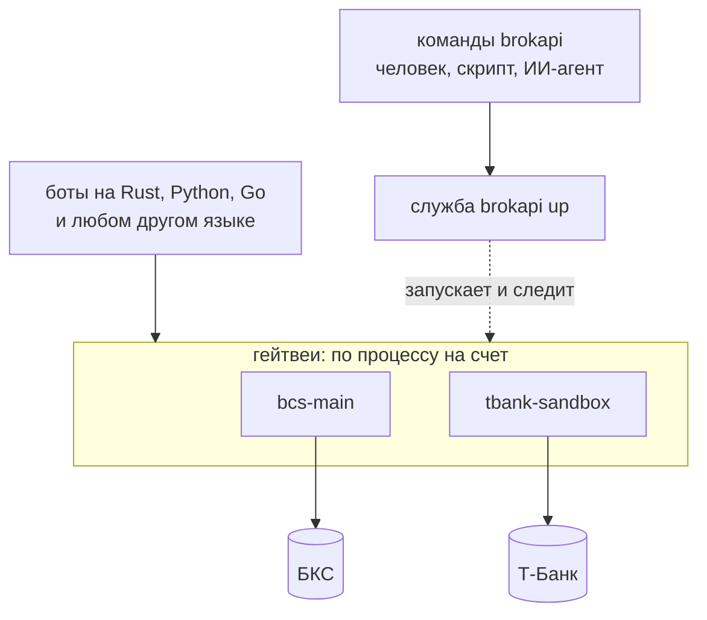

# Gateway

**Gateway** - программа `brokapi`: служба, которая держит связь с вашими счетами у брокеров за все боты сразу, и команды, которыми ею управляют.
Боты подключаются к службе, а не к брокеру. Бесплатно, ставится у себя, код открыт.

Это один продукт, а не два: `brokapi up` запускает службу, остальные команды (`ps`, `top`, `status`, `portfolio`, `cancel-all` и другие)
ею управляют и читают счет. Отдельной «командной строки» рядом нет, `brokapi` и есть командная строка.

В книге слово «гейтвей» означает процесс этой службы, который держит одно подключение к одному счету. Слово «шлюз» в других страницах
значит проверку внутри коннектора ([шлюз торговых команд](../reconcile.md)), это разные вещи.

## Когда он нужен

| Ситуация | Что брать |
|---|---|
| Один бот на Rust или Python, один счет | Библиотеку напрямую ([Rust](../rust/index.md), [Python](../python/index.md)). Лишний процесс не нужен |
| Несколько ботов на одном счете | Gateway. Один счетчик лимитов на всех. Без него каждый бот считает лимит сам, вместе они превышают квоту брокера, и брокер начинает отказывать |
| Бот не на Rust и не на Python | Gateway: бот подключается по gRPC, на любом языке, где gRPC есть |
| Бот на Python, которому нужен общий счетчик лимитов или связь, переживающая перезапуск бота | Gateway: `brokapi.connect_gateway` вместо `brokapi.connect`, остальной код бота тот же ([Подключить бота](bots.md#бот-на-python)) |
| Боты часто перезапускаются, а связь с брокером нужна постоянно | Gateway: связь живет дольше ботов, переподключение к брокеру и сверка заявок остаются за службой |
| Посмотреть счет или стакан из терминала, скриптом, ИИ-агентом | Команды `brokapi` (`portfolio`, `book`, `quote`, ключ `--json`). Бот для этого не нужен |

Если бот один и он на Rust или Python, Gateway ничего не добавит, кроме отдельного процесса.

## Как устроено

Схема показывает три слоя и то, кто с кем разговаривает. Команды и боты - клиенты, служба запускает гейтвеи, гейтвей один на счет и
единственный разговаривает с брокером.

1. **Гейтвей** - один процесс на одно подключение (брокер, счет, токен). Он держит соединение с брокером, переподключается, сверяет заявки,
   ведет счетчик лимитов, общий для всех его ботов, и журнал заявок. Наружу отдает gRPC для ботов.
2. **Служба** - фоновый процесс `brokapi up`. Читает [конфиг](config.md), запускает гейтвеи отдельными процессами, перезапускает упавшие, собирает
   их журналы и состояние, отвечает командам.
3. **Команды** - `brokapi ...`: клиенты службы и гейтвеев. Список: [Команды](commands.md).

**Почему процессы, а не потоки.** Если коннектор одного брокера упал или завис, остальные гейтвеи продолжают работать, а служба перезапускает
упавший. У каждого гейтвея своя память и свой токен. Будь все гейтвеи потоками одного процесса, паника или зависание в одном остановили бы все.

**Служба не обязана жить, пока живут гейтвеи.** Если процесс службы умер, гейтвеи продолжают работать и боты не замечают. Новая служба
(`brokapi up` с тем же конфигом) находит их по pid-файлам и сокетам и берет под присмотр.

**Несколько служб на одной машине.** Конфиг задает свой каталог состояния и свой сокет, поэтому `brokapi -c prod.toml up` и `brokapi -c test.toml up`
работают независимо. Увидеть все службы машины: `brokapi services`.

## Что гарантирует гейтвей

У каждой гарантии указано, что будет, если ее нет.

- **Один счетчик лимитов на всех ботов счета.** Два бота, у каждого свой счетчик, вместе выбирают квоту брокера, и брокер начинает отказывать
  обоим. Бот, который просит сверх бюджета, получает `RateLimited`, как если бы он был один. Очереди между ботами нет: бот, который
  занял всю квоту, оставит остальным отказы, пока ведро не пополнится ([Лимиты запросов](../limits.md)).
- **События с номерами.** Каждое событие гейтвея имеет номер. Бот, который переподключился, называет номер последнего обработанного события
  и получает пропущенное. Если пропущенного уже нет, он получает явный кадр `Gap` и обязан сделать сверку: без этого бот решил бы, что ничего
  не пропустил. Подробно: [События и сверка после перезапуска](events.md).
- **Медленный бот не тормозит остальных.** У каждого бота свой буфер. Переполнился - поток этого бота закрывается кадром `Lagged`, остальные
  ничего не замечают. Без этого один зависший бот копил бы события в памяти гейтвея, пока не остановил бы всех.
- **Перезапуск с открытыми заявками.** Номер заявки (`cid`) записывается в журнал гейтвея на диск до отправки заявки. После перезапуска гейтвей сверяет
  журнал с брокером и только потом принимает команды. Пока сверка идет, `Health` отвечает `starting`, а остальные вызовы получают `UNAVAILABLE`:
  так не случится, что бот выставил заявку, а гейтвей не знает про предыдущую. Это закрывает случай «упал после отправки, до ответа».
- **Подписки с владельцами.** Одинаковая подписка двух ботов - одна подписка у брокера. Снять ее может только тот, кто открыл, а когда бот
  пропал, его подписки снимаются через тридцать секунд. Иначе подписки копились бы у брокера и занимали его квоту.
- **Только эта машина.** Гейтвей слушает сокет в каталоге состояния (на Windows - `127.0.0.1`), а каждый вызов должен нести ключ из файла
  `access.key` с правами 600. Другой адрес гейтвей не откроет. Бот на другой машине подключиться не может: шифрования (TLS) у гейтвея нет.

## Чем отличается от библиотеки

Правила заявок, сверки и ошибок те же, что в [общих страницах](../architecture.md), но дорога у них другая, и это дает несколько отличий:
команда без ответа, номера событий, общий лимит, подписки. Все отличия с причинами: [Чем гейтвей отличается от прямого подключения](differences.md).

## Что есть и чего пока нет

| | |
|---|---|
| Есть | БКС, Т-Банк, Финам, АЛОР и Bybit за гейтвеем. Служба с перезапуском и подхватом гейтвеев. Несколько служб на машине. Команды из [справочника](commands.md). Клиент для ботов на Rust (`RemoteClient`) и на Python (`brokapi.connect_gateway`, тот же `Client`, что при прямом подключении). Контракт для любого языка: файлы `.proto`, справочник [Gateway (gRPC)](../api-gateway.md) |
| Пока нет | Клиента для ботов на Go: бот на этом языке подключается по `.proto` сам ([Подключить бота](bots.md#бот-на-другом-языке)). Очереди между ботами. Шифрования и доступа с других машин. Установки службы в систему одной командой: образец юнита systemd есть в [Запуске и обслуживании](operations.md#постоянный-запуск-systemd) |

## Куда дальше

- Попробовать за десять минут: [Быстрый старт](quickstart.md).
- Подключить своего бота: [Подключить бота](bots.md).
- Понять поток событий: [События и сверка после перезапуска](events.md).
- Держать службу постоянно: [Запуск и обслуживание](operations.md).
- Справочники: [Конфиг](config.md), [Команды](commands.md), [Gateway (gRPC)](../api-gateway.md).
