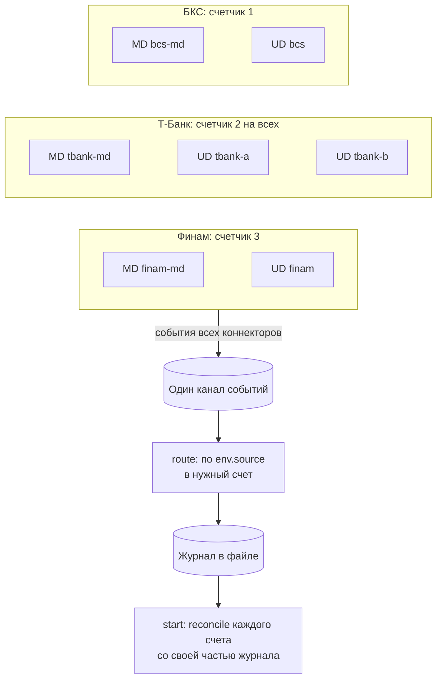

# Как собрать инфраструктуру на несколько брокеров и счетов

Инструкция. Цель: один процесс держит три брокера и четыре счета (БКС один, Т-Банк два на одном токене, Финам один), все события
идут в один канал, заявки пишутся в журнал в файле, а после рестарта каждый счет сверяется с журналом. Правила: [Контракт для
агентов](agent-contract.md), устройство: [Несколько счетов и брокеров](accounts.md). Код ниже - куски программы
`examples/infrastructure.rs`. Она запускается тестом против имитаций всех трех брокеров, и тест проходит две жизни процесса.

## Что получится

На схеме: коннекторы, общий канал, три счетчика лимитов (у каждого брокера свой), журнал. Т-Банк делит один счетчик между
рынком и обоими счетами, потому что считает лимит на пользователя.



Из схемы следует: UD на счет, MD на брокера, счетчик на область квоты. Метка `source` у коннектора, которую вы задаете в
настройке, - единственное, по чему в общем канале видно, чье событие. Поэтому метки UD равны именам счетов.

## Подключение

```toml
[package]
name = "my-bot"
edition = "2024"   # нужен Rust 1.85 или новее: в коде книги цепочки let

[dependencies]
brokapi = { version = "0.1.0-alpha.1", features = ["bcs", "tbank", "finam"] }
tokio   = { version = "1", features = ["full"] }
dotenv  = "0.15"
```

```rust,ignore
{{#include ../../examples/infrastructure.rs:imports}}
```

## Настройки

Все, что нужно для подключения, в одной структуре. В боевом запуске она строится из окружения (`BCS_REFRESH_TOKEN`,
`TBANK_TOKEN`, `TBANK_ACCOUNT_ID`, `TBANK_ACCOUNT_ID_2`, `FINAM_SECRET`, `FINAM_ACCOUNT_ID`), в примере - из имитаций.

```rust,ignore
{{#include ../../examples/infrastructure.rs:settings}}
```

Для пробного запуска без брокеров те же настройки собираются из имитаций (запуск имитаций и их константы: [Тесты против имитаций](mocks.md)):

```rust,ignore
{{#include ../../examples/infrastructure.rs:mock_settings}}
```

MD Т-Банка не привязан к счету: его конфиг без `account_id`. Счета выбирают конфиги UD.

## Журнал заявок в файле

Текстовый файл, одна строка на изменение: `счет, cid, состояние, пояснение`. Для каждой записи вызывается `sync_data`: журнал
должен быть на диске **до** вызова, который его требует. Побеждает последняя строка `cid`. Строка, оборванная падением,
пропускается при чтении.

```rust,ignore
{{#include ../../examples/infrastructure.rs:journal}}
```

## Что нужно процессу от счета

Три брокера - три разных типа коннекторов. Общий трейт `Account` (его реализуют все автоматически) дает единый вид, и
остальной код не знает, какой это брокер. Исход `place` сведен к четырем вариантам. Чтобы убрать счет, например оставить один
счет Т-Банка вместо двух, уберите его UD из `Infra`, из `accounts()` и из `ACCOUNTS`.

```rust,ignore
{{#include ../../examples/infrastructure.rs:account}}
```

## Запуск всех коннекторов

Порядок запуска: счетчики, канал, коннекторы, **подписки на статусы и сделки каждого счета**, и только потом `reconcile` каждого
счета со своей частью журнала. У Финама один JWT на MD и UD (`shared_tokens`).

```rust,ignore
{{#include ../../examples/infrastructure.rs:infra}}
```

## Вспомогательные функции

Читатель канала (`forward`), слова состояний для журнала и распознавание «брокер не знает заявку». Последнее у брокеров разное:
Все три брокера отвечают `Error::Rejected`: БКС и Финам с кодом `not_found`, Т-Банк с кодом `NOT_FOUND` (регистр не сравнивайте).
Терпение `NOT_FOUND_PATIENCE` в примере полсекунды для имитаций. Сколько нужно настоящему брокеру, не измерено, берите секунды.

```rust,ignore
{{#include ../../examples/infrastructure.rs:helpers}}
```

## Сверка при старте и после сбоя

Каждый счет сверяется со своей частью журнала. Из отчета: `confirmed` - заявка стоит, `closed_offline` - ее нет среди живых,
значит исполнилась, снялась, отклонилась или так и не была отправлена. Узнать итог можно запросом `order_state`. Если брокер
заявку не знает даже после ожидания, значит, процесс упал между записью в журнал и вызовом `place`: запись закрывается как
«не дошла». `foreign` показывается, но не трогается.

```rust,ignore
{{#include ../../examples/infrastructure.rs:reconcile}}
```

Сверка при старте идет через `reconcile_retry`: лимит или сбой сети не убивают процесс, а повторяются с паузой, остальные ошибки
возвращаются. После `Overflow` счета из `degraded` сверяются методом `recover`: сначала очередь читается до конца, потом
сверка.

```rust,ignore
{{#include ../../examples/infrastructure.rs:recover}}
```

## Заявка: журнал, вызов, журнал

```rust,ignore
{{#include ../../examples/infrastructure.rs:place}}
```

Вариант `NotSent` покрывает все ошибки, при которых ничего не ушло: закрытый шлюз, остановка, локальный лимит, неверная
настройка, неподдерживаемая возможность. `Unknown` и `Transport` оставляют заявку возможно существующей.

`Unknown` оставляет в журнале `Sending`. Эта запись попадет в список следующей сверки, и `order_state` скажет, чем кончилось.
Повторять `place` нельзя.

## Разбор общего канала

```rust,ignore
{{#include ../../examples/infrastructure.rs:route}}
```

Журнал не зависит от событий для правильности: `place` записывает `Working` по ответу, а сверка при старте исправит все остальное.
События лишь ускоряют запись итогов. Поэтому для примера не важно, что статусы БКС приходят после подключения сокета в фоне
([ловушка в тестах](mocks.md#ловушки-тестов)): потеряно только раннее событие, итог узнает сверка.

События маркетдаты (`bcs-md`, `tbank-md`, `finam-md`) инфраструктура пропускает: их читает стратегия. `Overflow` счета
помечает его как «сверить до торговли».

## Остановка

```rust,ignore
{{#include ../../examples/infrastructure.rs:stop}}
```

В отчете `shutdown` у БКС `unsubscribed` всегда 0: сессии WebSocket отписываются не отдельными сообщениями. У Т-Банка и Финама
счет подписок считается.

## Вся программа целиком

<details>
<summary>Текст программы examples/infrastructure.rs</summary>

```rust,ignore
{{#include ../../examples/infrastructure.rs}}
```

</details>

## Как проверить

```bash
cargo test --test examples infrastructure     # в клоне репозитория
cargo run --example infrastructure            # то же с выводом
```

Вне клона скопируйте файл программы выше в свой проект (зависимости как в начале страницы плюс `brokapi-mocks`) и вызовите
`run(&каталог)` из `main`.

Тест проходит две жизни процесса. Первая: заявка на каждом из четырех счетов, плюс строка журнала для заявки, которая так и не
была отправлена (падение между журналом и вызовом), процесс уходит, заявки остаются на бирже. Пока процесса нет, заявка
Т-Банка (счет A) исполняется. Вторая жизнь читает журнал и сверяет каждый счет. Проверяется: исполненная заявка закрыта как
`filled`, три живые найдены в `confirmed` и сняты процессом, неотправленная закрыта как «не дошла», чужих заявок нет.

## Что менять под себя

- **Состав счетов:** добавьте UD и имя в `ACCOUNTS` и `accounts()`. Правило прежнее: UD на счет, MD на брокера, счетчик на область.
- **Журнал:** вместо файла любая база. Условие одно: запись дошла до диска до вызова.
- **Стратегию** подключите к `route`: рыночные события не обрабатываются инфраструктурой, их можно отдавать стратегии по
  `env.source` и `env.sub`.
- **Автосверку после `Overflow`:** `degraded` содержит счета, которые надо сверить. Вызовите `reconcile` для каждого,
  предварительно дочитав канал ([Если что-то пошло не так](recovery.md#пришел-overflow-или-ошибка-degraded)).
