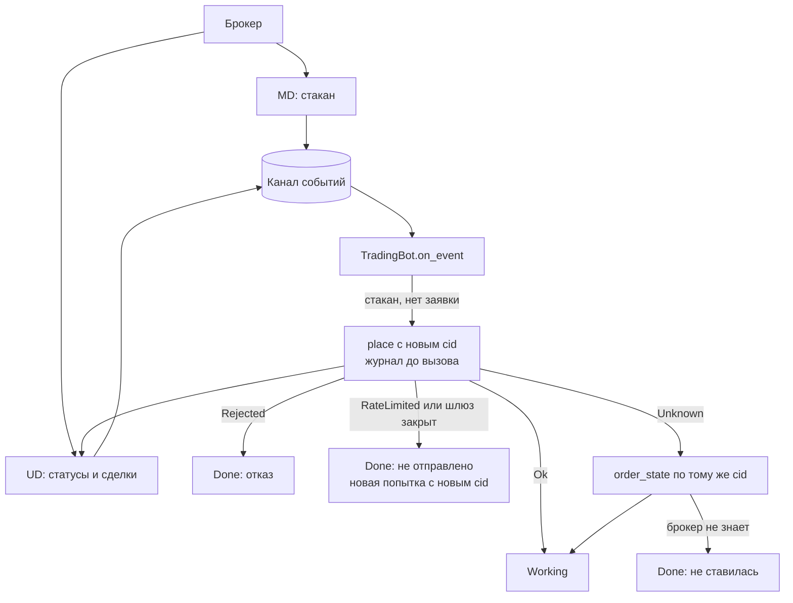

# Как написать торгового бота на событиях

Инструкция. Цель: бот, который читает стакан, по сигналу ставит заявку, следит за ее статусами, выходит из неясного исхода
(`Unknown`) и аккуратно останавливается. Правила, на которых он стоит, собраны в [Контракте для агентов](agent-contract.md),
причины - в [Круге команд](orders.md) и [Круге жизни](reconcile.md). Код ниже - куски программы `examples/trading_bot.rs`.
Она запускается тестом против имитаций БКС и Т-Банка, поэтому текст и проверенный код не расходятся.

Стратегия в примере заглушка: когда пришел стакан и своей заявки нет, купить минимальное количество на 1% ниже лучшей цены
покупки. Все остальное (журнал, сверка, исходы каждой команды, `Resync`, `Overflow`, остановка) нужно любому настоящему боту.

## Что получится

Бот написан на трейтах `brokapi::core` (`OrderBookSource`, `InstrumentSource`, `OrderExecutor`, `ExecutionSource`), поэтому
один и тот же `TradingBot` работает с любым из трех брокеров. На схеме: откуда идут события, где решает бот и что делает с
каждым исходом `place`.



Из схемы следует: ответ на `place` и статусы приходят разными путями (результат вызова и события), `Unknown` разбирается
запросом, а не повтором, и каждая развилка заканчивается записью в журнал.

## Подключение

```toml
[dependencies]
brokapi = { version = "0.1.0-alpha.1", features = ["bcs"] }   # или "tbank", "finam"
tokio   = { version = "1", features = ["full"] }
```

Крейт не опубликован, пока его подключают по пути: `brokapi = { path = "../brokapi", features = ["bcs"] }`.

```rust,ignore
{{#include ../../examples/trading_bot.rs:imports}}
```

## Журнал

Журнал - память бота. Библиотека не пишет на диск ничего. В примере он в памяти, чтобы код был короче. Настоящий бот пишет
каждое изменение в файл или базу до того, как идти дальше: готовый журнал в файле - в [инструкции про несколько брокеров и
счетов](howto-infrastructure.md#журнал-заявок-в-файле).

```rust,ignore
{{#include ../../examples/trading_bot.rs:journal}}
```

## Подключение коннекторов

Один счетчик лимитов на токен (БКС считает лимит на токен) и один канал для событий обоих коннекторов. Канал читает отдельная
маленькая задача (`forward`, ниже): она сразу переносит конверты в очередь бота. Это нужно, потому что бот в ходе работы ждет
ответы брокера (`place` до 30 секунд), а коннектор не умеет ждать читателя: если канал не читается, буфер заполняется и приходит
`Overflow` ([Контракт, правило 5](agent-contract.md#5-свои-заявки-и-сделки-идут-только-lossless-канал-читать-всегда)).

```rust,ignore
{{#include ../../examples/trading_bot.rs:types}}
```

Константы и вспомогательные функции программы: покупка по 99% лучшей цены (`Price * Decimal` дает `Price`), идентификатор
инструмента у БКС и читатель канала.

```rust,ignore
{{#include ../../examples/trading_bot.rs:wiring}}
```

## Старт бота: подписка, сверка, правила инструмента

`TradingBot::start` делает все по порядку: подписка на статусы и сделки, `reconcile` со списком из журнала, правила
инструмента (шаг цены, минимальное количество), подписка на стакан. Пока `start` не вернулся, бот не торгует.

```rust,ignore
{{#include ../../examples/trading_bot.rs:bot}}
```

Что видно в коде:

- Событие `Resync` обнуляет сохраненный стакан (`self.top = None`). Следующий снимок его заменит.
- `Overflow` не обрабатывается на месте, а ставит флаг: сверку и дочитывание канала делает цикл, у которого есть канал.
- Состояние заявки берется из потока статусов (`on_order`), а не из ответа на `place`. Ответ значит «брокер принял».
- В поток статусов попадают **все** заявки счета, в том числе поставленные руками. `on_order` пропускает те, которых нет в журнале:
  чужую заявку бот в свой журнал не вносит ([Контракт, правило 11](agent-contract.md#11-чужие-заявки-не-трогать)).
- Сколько исполнено, бот считает по полю `filled` снимков заявок, а не складывает события `Execution`. Тогда после
  `Overflow` сверка сама возвращает правильное число (`reconcile` и `order_state` дают снимки).
- `Overflow` бывает двух видов. Если переполнилась **подписка на стакан** (ее `sub` и метка коннектора известны боту), стакан
  объявляется недействительным и подписка оформляется заново. Если переполнился поток своих заявок, нужна сверка.

## Сигнал и заявка со всеми исходами

```rust,ignore
{{#include ../../examples/trading_bot.rs:place}}
```

Повтор по таймеру: `on_tick` вызывается раз в четверть секунды. После `RateLimited` или закрытого шлюза тихий стакан сам повтор не
запустит (имитация БКС присылает один снимок), поэтому повтор ведет таймер, а не только следующий стакан.

Таблица исходов этого куска:

| Что вернул `place` | Что значит | Что делает бот |
|---|---|---|
| `Ok` | брокер принял, заявка стоит | запись `Working`, ждет статусов |
| `Rejected` | брокер точно отказал, заявки нет | запись `Done`, новая попытка только с новым `cid` |
| `NotReconciled`, `Degraded` | шлюз закрыт, ничего не ушло | пометка «сверить», запись `Done: не отправлено` |
| `RateLimited` | квоты нет, ничего не ушло | пауза на `retry_after`, потом новый `cid` |
| `Unknown`, `Transport` | команда могла дойти | запись `Check`, `order_state` по тому же `cid` |
| остальное | настройка, `Unsupported`, остановка | бот останавливается с ошибкой |

## Выход из `Unknown`

Заявку **не** ставят второй раз. Спрашивают брокера по тому же `cid`. «Не найдена» сразу после обрыва не окончательно:
запрос мог быть в пути, поэтому бот ждет и спрашивает еще раз, а сдается только по истечении терпения.

```rust,ignore
{{#include ../../examples/trading_bot.rs:unknown}}
```

Тест запускает этот путь по-настоящему: имитация Т-Банка отвечает на `place` через 1,5 секунды, коннектор ждет 200
миллисекунд и возвращает `Unknown`, заявка при этом встала. Бот находит ее через `order_state`, и в журнале ровно одна
заявка.

## `Overflow`: дочитать, сверить

```rust,ignore
{{#include ../../examples/trading_bot.rs:recover}}
```

## Цикл событий

Бот разбирает свою очередь одним циклом, рядом с ним тикает таймер повторов (`on_tick`). Тест играет биржу: когда заявка встала, исполняет ее (`server.fill`) или просит бота
остановиться. Задержка `deadline` нужна только затем, чтобы пример не завис при ошибке.

```rust,ignore
{{#include ../../examples/trading_bot.rs:loop}}
```

## Остановка

Бот перестает ставить заявки, снимает свою рабочую заявку, дожидается финального статуса и записывает его. Снимать ли заявки -
решение бота: библиотека при `shutdown` ничего не снимает. Отмена не бросается при первом сбое: `RateLimited` ждет и повторяет,
закрытый шлюз сверяется, `Unknown` разбирается через `order_state` (повторная отмена новых заявок не создает).

Остановка по Ctrl-C та же: ловите сигнал в `select!` рядом с циклом событий и вызывайте тот же `stop`.

```rust,ignore
tokio::select! {
    env = queue.recv() => { /* bot.on_event(...) */ }
    _ = tokio::signal::ctrl_c() => break,   // потом bot.stop(&mut queue), shutdown
}
```

```rust,ignore
{{#include ../../examples/trading_bot.rs:stop}}
```

Потом коннекторы: сначала UD, затем MD. `shutdown` забирает коннектор по значению, а бот держит на него ссылку, поэтому бота
отпускают раньше (`drop(bot)`, иначе ошибка компиляции `cannot move out of ... because it is borrowed`).

```rust,ignore
{{#include ../../examples/trading_bot.rs:shutdown}}
```

`inflight_abandoned` в отчете - команды, на которые еще не пришел ответ. После нормально завершенных заявок он пуст.

## Как запустить

```bash
cargo test --test examples trading_bot      # три теста: исполнение, остановка с отменой, выход из Unknown
cargo run --example trading_bot             # то же на имитации БКС с выводом
```

## Вся программа целиком

Для копирования: файл `examples/trading_bot.rs` как есть (в `Cargo.toml` те же зависимости, что выше, плюс
`brokapi-mocks` из [страницы про имитации](mocks.md)). Часть с `run_bcs` и `run_tbank_unknown` запускает бота против имитаций.

<details>
<summary>Текст программы</summary>

```rust,ignore
{{#include ../../examples/trading_bot.rs}}
```

</details>

## Как проверить результат

Что проверяют тесты. Цена заявки равна 99% лучшей цены покупки, округленной вниз до шага (241.85 при 244.30 и шаге 0.01).
В журнале ровно одна запись. После исполнения запись `filled`, после остановки `cancelled`. В сценарии с потерянным ответом
заявка одна.

## Что менять под себя

- **Стратегию:** функция `try_buy`, место, где вычисляется цена и количество. Все вокруг нее оставьте.
- **Брокера:** замените подключение (`wiring`). Для Т-Банка идентификатор инструмента берется из справочника
  (`find`, пример `run_tbank_unknown`), для Финама собирается из `SBER@MISX` ([Быстрый старт](quickstart.md)).
- **Журнал:** замените на файл или базу, запись до `place` с принудительной записью на диск.
- **Несколько заявок и инструментов:** состояние `working` станет таблицей по `cid`, очередь по бумаге библиотека
  держит сама ([Круг команд](orders.md#порядок-команд-по-бумаге)).
- **Боевой счет:** сначала [Перед запуском на настоящем счете](agent-contract.md#перед-запуском-на-настоящем-счете).
