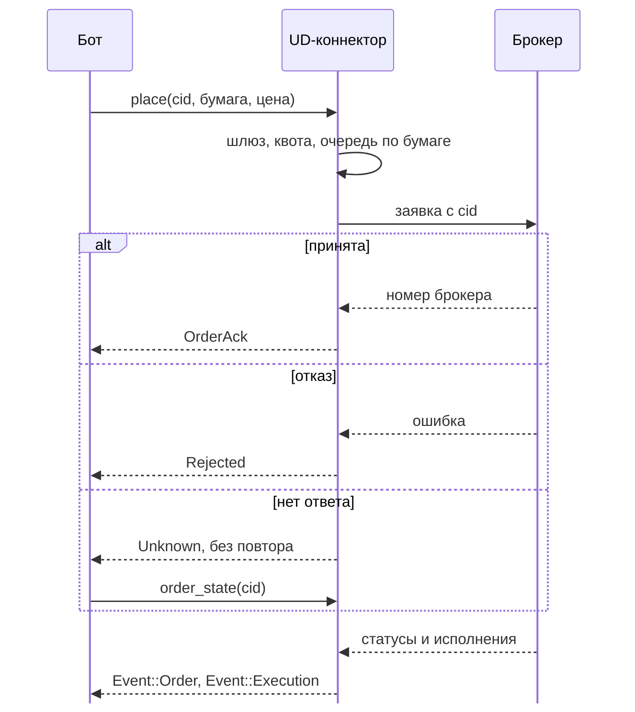
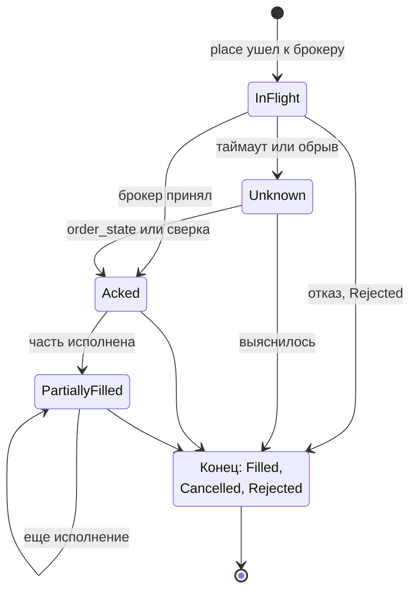

# Круг команд: заявки

Страница объясняет, что происходит с заявкой от вызова `place` до исполнения и что бот делает в каждом случае.
Три правила, на которых держится вся библиотека, - в [начале книги](README.md#три-правила-на-которых-все-держится).
Схема самого круга - на [Карте](architecture.md#круг-команд-бот---брокер), здесь ее подробности. Исходы и коды
отказов собраны на странице [Ошибки и что с ними делать](errors.md), порядок действий после неясного исхода - на
странице [Если что-то пошло не так](rust/recovery.md).

## cid: номер заявки

`cid` (`ClientOrderId`) - это UUID, который бот создает сам: `ClientOrderId::new_v4()`. Библиотека номера не
придумывает. Причины:

- **Библиотека ничего не помнит между запусками.** Она не пишет на диск. После рестарта бот приносит список своих
  `cid`, и по нему заявки на счете делятся на свои и чужие ([Круг жизни](reconcile.md)).
- **Номер нужен до отправки.** Если ответа нет, `cid` - единственная нить, по которой можно спросить брокера:
  «что с заявкой, которую я пытался поставить?». Если бы номер выдавала библиотека, он потерялся бы вместе с ответом.
- **Случайный UUID не требует согласования.** Столкновение практически невозможно, ни один процесс ни с кем не
  координируется.

Правила для бота:

- Один `cid` - одна заявка. **Новая попытка - новый `cid`.** Старый `cid` библиотека повторно не отправит: вернет
  `Rejected` с кодом `duplicate_place`, в сеть ничего не уйдет. Это касается и тех попыток, которые закончились
  отказом брокера. Зачем так жестко: после таймаута первая заявка могла дойти. Что брокер сделает с повтором того
  же номера, зависит от брокера (`LabelOnly`, см. ниже), и надеяться, что он отбросит дубль, нельзя.
- Единственное исключение: вызов отвергнут **до отправки**, когда `cid` еще не помечен использованным. Так бывает при
  `NotReconciled`, `Degraded` и `ShuttingDown`, при ошибке входа (`missing_price`, `invalid_qty`, идентификатор инструмента
  другого брокера) и при
  `RateLimited`. Заявки нет, `cid` годен, после устранения причины его можно использовать снова (у всех брокеров). Не уверены - берите новый `cid`, это всегда безопасно.
- Перед вызовом `place` запишите `cid` в свой журнал (состояние «отправляю»). Иначе после падения процесса между
  отправкой и записью вы потеряете заявку, о которой не знаете.
- Для изменения заявки (`replace`) нужен **новый** `cid`: старый указывается как `original_cid`.

### Как cid уходит к брокеру

| Брокер | Куда кладем | Обратимо |
|---|---|---|
| БКС | поле `clientOrderId`, UUID с дефисами как есть | да |
| Т-Банк | поле `order_id` (это ключ идемпотентности, 36 символов), UUID с дефисами как есть. Брокер возвращает его же как `order_request_id`, по нему работают отмена и чтение статуса | да |
| Финам | поле `client_order_id` вмещает всего 20 символов, UUID туда не помещается. Поэтому полный номер кладется в комментарий заявки в виде `bc1:` и 32 символа, а в `client_order_id` идет короткая метка из 20 символов, получаемая из UUID. Метка по себе номер не восстанавливает | да, **если Финам возвращает комментарий без изменений** |
| АЛОР | поле `comment` заявки (до 100 символов), UUID с дефисами как есть, и тот же текст в заголовке `X-REQID` команды. Комментарий возвращается в списке заявок, в потоке и в сделках | да |
| Bybit | поле `orderLinkId` (до 36 символов), UUID с дефисами как есть. Повтор того же `orderLinkId` биржа отвергает (код 110072), но как долго она помнит закрытую заявку, в документации не названо | да |

У всех «защиту от повторной отправки той же заявки» библиотека пока считает отсутствующей (`LabelOnly`).
Что делает брокер с повтором, измерят только живые прогоны. Это не меняет правило: повторять заявку нельзя.

## Что происходит в `place`

Порядок проверок у всех брокеров один, и он показан на схеме круга: [Карта](architecture.md#круг-команд-бот---брокер).
Сначала шлюз команд, потом проверка входа без сети, потом квота у счетчика лимитов, потом очередь по бумаге, потом **шлюз
еще раз**, и только после этого `cid` помечается использованным и команда уходит к брокеру. Почему именно так:

- **Дешевые проверки первыми.** Шлюз, вход и квота не требуют ни сети, ни ожидания. Отказ на любой из них ничего не
  тратит: ни `cid`, ни времени в очереди.
- **Квота до очереди.** Отказ по квоте приходит сразу, а не после ожидания за другими командами по бумаге.
- **Шлюз проверяется второй раз после очереди.** Команда могла простоять в очереди за другой командой по той же бумаге, и
  за это время шлюз закрылся: оборвался поток заявок или исполнений (`Event::Reconnected`), переполнился буфер
  (`Overflow`), началась остановка. Закрытый шлюз значит, что в сеть ничего не уходит, и это верно и для команды, которая
  уже стоит в очереди: она получает `Degraded` или `ShuttingDown`, а не уходит к брокеру. Для `cancel` и `cancel_stop` так же.
- **`cid` помечается как можно позже, прямо перед отправкой.** Пока вызов стоит в очереди, номер чистый: если вызов
  отменили или он не дошел до отправки, номером можно воспользоваться снова. Пометка сразу после очереди и до
  сети: второй `place` с тем же `cid` увидит ее и не уйдет.
- Отказ `duplicate_place` приходит уже после квоты и очереди, поэтому единица квоты на него потрачена, хотя в сеть
  ничего не ушло.

Все, что находится выше отправки, **не доходит до брокера**: можно не сомневаться, что заявки нет. На схеме ниже
- тот же путь во времени: бот, UD-коннектор и брокер.



Ответ на `place` и статусы приходят разными путями: ответ - результатом вызова, статусы и исполнения - событиями в
общем канале. Порядок между результатом вызова и событием не гарантирован: событие может прийти и после ответа, и раньше него. Поэтому после `OrderAck` заявка еще не исполнена, это только «брокер принял». Ждать исполнения нужно
по `Event::Order` и `Event::Execution`, а не по ответу.

## Исходы команды

Любая команда (`place`, `cancel`, `replace`, стоп-команды) заканчивается одним из трех видов исхода, и они отвечают
на главный вопрос: **дошла ли команда до брокера**.

1. **Не дошла.** Закрыт шлюз (`NotReconciled`, `Degraded`, `ShuttingDown`), не прошла проверка входа или
   `Unsupported`, не хватило квоты (`RateLimited`), неверная настройка (`Config`). Заявки нет, делать с ней нечего,
   исправляется причина.
2. **Дошла и получила ответ.** `Ok(OrderAck)` - брокер принял. `Rejected` - брокер **точно** отказал, заявки нет.
3. **Дошла, ответа нет.** `Unknown` (и `Transport` на команде, если брокер мог ее получить). Заявка **могла** встать.
   Это единственный исход, где нельзя ни повторять, ни считать, что заявки нет.

Таблица «исход -> что значит -> почему бывает -> что делать» лежит в [справочнике ошибок](errors.md), там же коды
`Rejected`. Особенности перевода ответов в исходы:

- **БКС.** Отказ может прийти не ошибкой HTTP, а внутри обычного ответа 200 (статус заявки 8, `rejectReason`).
  Библиотека читает оба случая и возвращает `Rejected`.
- **Т-Банк.** Брокер может принять запрос и ответить статусом «отклонено» внутри ответа. Это тоже `Rejected` (код
  `REJECTED`).
- **Проверка входа до отправки** у всех одна. Количество: положительное, целое там, где брокер берет целые (БКС, Т-Банк),
  и кратное лоту, если лот известен. Иначе `Rejected` с кодом `invalid_qty`. Ничего не округляется: дробное количество
  там, где брокер берет целые, это отказ. Количество в **единицах инструмента**, не в лотах, у любого
  брокера ([Деньги, цены и количества](numbers.md#количество-единицы-инструмента-не-лоты)). Цену коннектор сверяет с
  шагом, если шаг ему передан (`price_grid()`): цена не на шаге - `Rejected { price_off_step }` до отправки, квота и
  `cid` не тратятся. Идентификатор инструмента другого брокера (например `SymbolMic` Финама у Т-Банка) это `Config`, без
  сети. Как округлить цену точно и как передать шаг - [Деньги, цены и количества](numbers.md).

### Как это выглядит в коде

Номер придумывает бот и записывает в журнал до вызова. Вкладка выбирает язык, выбор запоминается для всей книги.

<div class="lang-tabs">

```rust,ignore
{{#include ../../examples/contract.rs:cid_first}}
```

```python
{{#include ../../crates/python/examples/rules.py:cid_first}}
```

</div>

Исходы разбираются так, что «заявки точно нет» и «заявка могла встать» никогда не путаются. На `Unknown` и `Transport` повтора нет,
есть вопрос брокеру по тому же `cid`. Библиотека держит то же правило со своей стороны: после `Unknown` и `Transport` тот же `cid`
дает `duplicate_place` и к брокеру не уходит:

<div class="lang-tabs">

```rust,ignore
{{#include ../../examples/contract.rs:unknown}}
```

```python
{{#include ../../crates/python/examples/rules.py:unknown}}
```

</div>

В Python это исключения `brokapi.Rejected`, `brokapi.Unknown` и `brokapi.Transport` из `brokapi.errors`: те же имена и тот же текст, что у
`Error` в Rust. Если задачу, которая ждет `place`, отменить в Python, команда все равно доходит до конца: после этого тоже
спрашивайте `order_state`.

## Почему нет автоповтора

Заявка, которая ушла к брокеру и осталась без ответа, может находиться в трех состояниях: брокер ее не получил,
получил и поставил, получил и отклонил. Из «нет ответа» этого не понять. Если отправить заявку еще раз, а первая
все-таки встала, на счете окажутся **две заявки**. Для денег это худший исход, поэтому библиотека повторяет только
то, что безопасно (чтение), и никогда не повторяет команды.

То же относится к тому, что библиотека не делает сама после ошибки: не пробует другую форму запроса, не меняет
количество и цену, не ставит заявку заново.

У всех брокеров таймаут на `place` дает
`Unknown`, второй вызов с тем же `cid` не уходит в сеть (`duplicate_place`), а заявка, которую брокер все-таки принял,
находится через `order_state`.

Что делать вместо повтора: спросить брокера по `cid`, это описано в [Если что-то пошло не так](rust/recovery.md#place-вернул-unknown).

## `cancel`

`cancel(cid)` снимает заявку по вашему `cid`. Исходы те же, что и у `place`. Особенности:

- `Ok(())` значит: брокер подтвердил отмену. У БКС команда синхронная, и «отменено» говорится только тогда, когда
  брокер сам ответил, что заявка отменена.
- Заявка уже исполнилась: БКС вернет `Rejected` с кодом `already_filled`, остальные - отказ брокера.
- `Unknown`: отмену **можно** повторить вручную после проверки `order_state`. Повторная отмена новых заявок не
  создает. Библиотека сама ее не повторяет.
- У БКС, если после синхронной отмены заявка по ответу еще жива, результат тоже `Unknown`: «отменено» не
  объявляется без подтверждения. Так бывает со статусом 6 «Отменяется (в процессе отмены)»: заявка еще стоит в стакане и
  может исполниться раньше, чем отмена дойдет до конца. Такой статус приходит как состояние `Unknown`, не `Cancelled`.
  `Cancelled` будет, когда брокер пришлет статус 4, а если заявка успела исполниться, придет `Filled`.
- Отмена идет через отдельное ведро лимитов, постановка ее не вытесняет ([Лимиты запросов](limits.md)).

## `replace`: изменить заявку

`replace(ReplaceOrderRequest { cid, original_cid, qty, price })` меняет количество и (или) цену. `cid` - **новый**
номер, `original_cid` - заявки, которую меняем. Количество и цена, которых вы не указали, берутся от исходной
заявки (коннектор для этого один раз читает ее у брокера).

| Брокер | Как | Особенности |
|---|---|---|
| БКС | `POST /orders/edit/sync`: брокер снимает исходную заявку и ставит новую под новым `cid` | У частично исполненной заявки количество нужно указать явно (`qty_required`). Что означает количество при правке (весь объем или остаток), в документации не сказано: укажите количество явно |
| Т-Банк | `ReplaceOrder`. Новый `cid` становится ключом идемпотентности | Биржевой номер после замены может измениться, ориентируйтесь на `cid` |
| Финам | **нет**. `replace` возвращает `Unsupported("replace_order")` сразу, без сети | В API Финама такого метода нет. Отмену и новую заявку библиотека не подменяет: они не атомарны (старая может исполниться между шагами, новую могут отклонить после отмены). Решение за ботом |
| АЛОР | `PUT` лимитной заявки по номеру: брокер снимает исходную и ставит новую под новым `cid` в комментарии | Рыночную заявку заменить нельзя (`not_replaceable`). У частично исполненной количество нужно указать явно (`qty_required`) |
| Bybit | **нет**. `replace` возвращает `Unsupported` сразу, без сети | Изменение заявки у биржи (`POST /v5/order/amend`) оставляет заявку и ее `orderLinkId`, а `replace` обещает новую заявку под новым `cid`. Одно за другое не выдается: снимите заявку и поставьте новую, либо измените через `raw()` и помните, что `cid` прежний |

`Unknown` на `replace` неприятнее, чем на `place`: непонятно, что с обеими заявками. Спрашивайте `order_state` по
**обоим** номерам, и по исходному, и по новому.

## Машина состояний заявки

Состояние приходит в `Event::Order` (поле `state` в `OrderSnapshot`) и в ответе `order_state`. На схеме: состояния
заявки и переходы между ними. Каждый переход - событие `Event::Order`, и в каждом есть `cid`.



Из `Unknown` библиотека сама не выходит: только запрос состояния или сверка. Это сделано намеренно: любое «само
выяснилось» было бы догадкой, а на догадке нельзя ставить вторую заявку. Из конечных состояний выхода нет, поэтому
событие о конце можно считать окончательным.

| Состояние | Значение |
|---|---|
| `InFlight` | команда отправлена, ответа еще нет. Внутреннее состояние |
| `Unknown` | таймаут или обрыв, а у БКС еще статус 6 «отменяется»: заявка может быть жива. Выход только через запрос состояния или сверку. Библиотека сама из него не выходит |
| `Acked` | брокер принял, заявка стоит в стакане. Есть номер брокера |
| `PartiallyFilled` | исполнена часть: известно, сколько исполнено (`filled`) и сколько осталось (`left`) |
| `Filled` | исполнена целиком. Конечное |
| `Cancelled` | снята (по вашей отмене, по замене, по сроку). Конечное |
| `Rejected` | отклонена, с причиной. Конечное |

Статусы брокеров переводятся в эти состояния. Статус, который библиотека не знает, у Финама считается рабочей
заявкой, а неопределенный статус Т-Банка переводится в `Unknown`.

## Порядок команд по бумаге

Команды по одному инструменту выполняются **строго по очереди**, в порядке вызова: отмена, отправленная после
постановки, не обгонит ее. Если бы обгоняла, отмена пришла бы к брокеру раньше заявки, ответила бы «такой нет», а
потом заявка встала бы и осталась на счете, хотя бот считает ее снятой. Реализовано блокировкой на инструмент
(`InstrumentLocks`). Особенности:

- Ключ блокировки - `symbol@mic`, а не весь идентификатор. Один инструмент, названный тикером, `uid` или
  `figi`, - одна очередь.
- Блокировка снимается при любом исходе: отказ, ошибка сети, отмена вызова.
- Отказ брокера бумагу **не блокирует**. Это проверяется отдельным сценарием (в БКС однажды ошибка оставляла
  бумагу занятой до перезапуска).
- Для `cancel` бумага берется из заявок, которые поставил этот процесс. Если заявка осталась с прошлого запуска и
  бумага процессу неизвестна, `cancel` в очередь не встает.
- Команды по **разным** бумагам идут параллельно.

## Сколько ждать ответа

Время ожидания ответа на команду задается в настройке клиента брокера: у Т-Банка, БКС, АЛОРа и Bybit 30 секунд по умолчанию,
у Финама 10 секунд. По истечении ответ `Unknown`. Пока команда ждет, она занимает очередь по бумаге, поэтому
следующие команды по той же бумаге ждут за ней. Слишком короткий таймаут плодит `Unknown` на заявках, которые
брокер успел бы принять, слишком длинный держит очередь по бумаге.

## Что бот хранит

Минимум для работы с заявками: журнал `cid` (что отправлено, что подтверждено, что закрыто), пометка «проверить» у
заявок с неясным исходом и номер брокера (`broker_id`), если он нужен для отмены стопов у Т-Банка
([Стоп-заявки](rust/stop-orders.md)). Что хранит бот, а что библиотека: [Круг жизни](reconcile.md#что-хранит-бот-а-что-нет).
