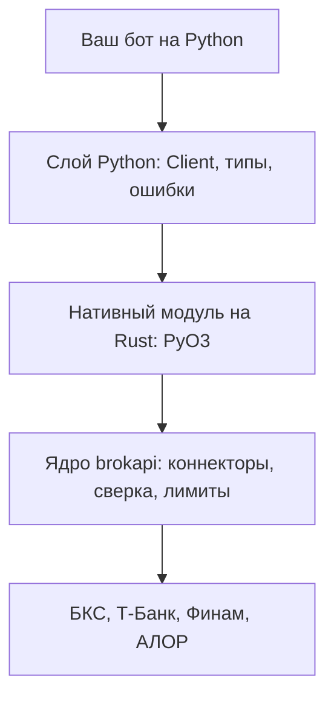

# Как Python связан с ядром

Объяснение. Страница про то, как устроена обертка, чем она отличается от Rust и почему сделано именно так. Чтобы писать бота, она
не нужна, но отвечает на вопросы «а что под капотом» и «почему тут не так, как в Rust».

## Из чего состоит пакет

Пакет `brokapi` - тонкая обертка. Всю работу (протоколы брокеров, сверку, лимиты, правила заявок) делает ядро на Rust, то же,
что у Rust-пути. Нативный модуль собран PyO3 в один файл на все версии Python от 3.10 (`abi3`). Сверху лежит слой на Python: типы,
ошибки, понятный `async for` и подсказки для редактора.

Из схемы следует: правил в Python-слое нет. Он только переводит вызовы и данные туда и обратно, поэтому поведение у Python и Rust
одно, а ошибка в правиле исправляется в одном месте.

## Мост между tokio и asyncio

Ядро работает на асинхронном рантайме tokio, бот на Python на цикле `asyncio`. Мост - библиотека `pyo3-async-runtimes`: каждый
асинхронный метод ядра становится ожидаемым объектом (`awaitable`) цикла, который сейчас работает. Метод запускается на потоках
tokio, а результат возвращается в тот же цикл `asyncio`, в котором его ждут.

Три следствия, о которых надо знать:

- **Команда не отменяется вместе с ожиданием.** Если задачу, которая ждет `place`, отменить (или оборвать по таймауту), команда
  все равно доходит до конца внутри библиотеки. Иначе заявка, оборванная на полпути, могла бы уже лежать у брокера, а бот
  решил бы, что ее нет. Поэтому после отмены ожидания у `place`, `cancel`, `replace` и `reconcile` спрашивайте у брокера, чем
  кончилось (`order_state`, события). Чтение отменяется как обычно.
- **События читаются из одного канала.** У клиента один поток событий, как у Rust один канал. Пока его не читают, подписки
  применяют свои правила (склеить, отбросить, копить без потерь), и копящая без потерь при переполнении закрывает торговлю. Поэтому
  поток читает одно место, а долгую работу бот выносит в свою очередь.
- **Один клиент можно звать из многих задач.** Вызовы идут параллельно, по одному инструменту команды выстраиваются в очередь
  внутри ядра ([Круг команд](../orders.md#порядок-команд-по-бумаге)).

## Как проходят данные

Данные идут через границу текстом JSON: типы ядра уже умеют записываться в JSON, а слой Python превращает текст в классы с
`Decimal` и аккуратным временем. Цены, количества и деньги в JSON лежат строками, и точное число остается точным до самого
`Decimal`: ни на одном шаге оно не становится `float`.

- В вызов можно передать `Decimal`, `int` или строку. `float` отвергается с `TypeError`: из `0.1` никакое округление не вернет
  точное число.
- Время - `datetime` с часовым поясом (UTC), точность до микросекунд. Точные наносекунды лежат в `Timestamps`. `datetime` без пояса
  отвергается: неясно, о каком времени речь.
- Обход через JSON на вызов добавляет работу процессора, но рядом с сетью брокера она мала. Замер на живых брокерах не делался. Если
  это станет узким местом, текст можно заменить на прямые объекты, интерфейс при этом не изменится.

Ядро делает работу и держит правила, Python остается способом ими управлять. brokapi не торговый движок: в нем нет стратегий, учета
позиций и бэктеста, только подключение к брокерам.

## Ошибки

Класс исключения на каждый вариант `Error` ядра, с тем же именем и тем же текстом: `Config`, `Transport`, `RateLimited`, `Rejected`,
`Unknown`, `Unsupported`, `NotReconciled`, `Degraded`, `ShuttingDown`. Все они наследуют `brokapi.BrokapiError`. Текст исключения
(`str(error)`) побуквенно равен тексту `Display` в Rust, это проверяет тест: так описание на странице [Ошибки](../errors.md) верно и
для Python. Поля вариантов лежат в атрибутах: `Rejected.code`, `Rejected.message`, `RateLimited.retry_after` (`timedelta`),
`Unsupported.capability`. Ответ на вопрос «можно ли повторить» дает `error.error_class`: `RETRYABLE`, `FATAL` или `UNKNOWN`.

Ошибки журнала событий (файл, строка, версия) - еще один класс того же семейства, `LogError`, с тем же текстом, что `LogError` в Rust.

Два исключения вне семейства: `ValueError` (аргумент не годится, ничего не отправлено) и `RuntimeError` при вызове метода закрытого
клиента. Вариант ошибки, которого этот пакет еще не знает (ядро новее пакета), приходит как `BrokapiError` с текстом ядра, а событие
неизвестного вида - как `UnknownEvent`: цикл бота не падает.

## Чем отличается от Rust

| | Rust | Python |
|---|---|---|
| Подключение | два коннектора, лимиты и канал собирает бот | `await brokapi.connect(...)`: все собрано, лимиты делятся через `limiter=` |
| События | `mpsc::Receiver<Envelope>`, общий на сколько угодно коннекторов | `client.events` на клиента, `brokapi.merge` склеивает |
| Деньги | `Price`, `Qty`, `Money` | `Decimal` |
| Идентификатор заявки | `ClientOrderId` | `uuid.UUID` (`brokapi.new_cid()`) |
| Шаг цены коннектору | `ud.price_grid().learn(&params)` | делает `trading_params` |
| Состояния заявки | варианты `OrderState` | `OrderState.kind` (`OrderStateKind`) и поля |
| Стоп-заявки | `StopOrderExecutor` | `place_stop`, `cancel_stop`, `active_stop_orders`, `subscribe_stop_orders` |
| `raw()` | замыкание над типизированным клиентом брокера, потоки отдаются | `await client.raw(имя, словарь)`, ответ словарем, потоки не отдаются |
| Запись и проигрыш событий | `EnvelopeWriter`, `EnvelopeReader`, `replay` | `brokapi.record`, файл тот же |

Что не меняется: порядок «подписка, сверка, торговля», `cid` от бота, `Unknown` без повтора, один счетчик лимитов на область.
