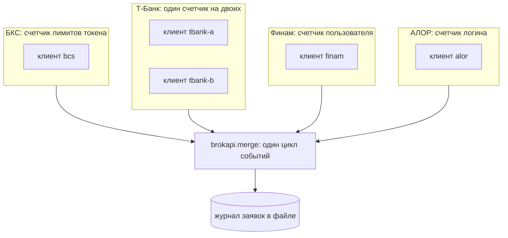

# Как собрать инфраструктуру на несколько брокеров и счетов (Python)

Инструкция. Цель: один процесс держит несколько брокеров и несколько счетов, читает события всех одним циклом, ведет один
журнал заявок в файле и после рестарта сверяет каждый счет с этим журналом. Правила: [Контракт для агентов](../agent-contract.md),
логика счетов и лимитов: [Несколько счетов и брокеров](../rust/accounts.md). Код ниже - куски программы `infrastructure.py`.
Она запускается тестом против имитаций брокеров: две жизни процесса, между ними одна заявка исполняется.

В примере несколько счетов: БКС (один), Т-Банк (два, один токен), Финам (один) и АЛОР (один).

## Что получится

Один клиент на счет. Клиенты одного брокера делят счетчик лимитов, клиенты разных брокеров нет.



Из схемы следует: брокер считает лимит на токен или пользователя, поэтому два клиента одного токена обязаны делить счетчик
(`limiter=`), а чужого брокера счетчик не касается. События всех клиентов идут в один цикл, и поле `source` говорит, чье это событие.

## Журнал заявок в файле

Текстовый файл, строка на изменение: `счет`, `cid`, состояние, подробность. Последняя строка по `cid` главная. Каждая строка
сбрасывается на диск **до** вызова, которому нужна: строка «отправляю» пишется до `place`, иначе сбой между отправкой и записью
теряет заявку.

```python
{{#include ../../../crates/python/examples/infrastructure.py:journal}}
```

## Подключение, подписки, сверка

Подключение идет по порядку: клиенты, подписки на статусы и исполнения каждого счета, и только потом сверка каждого счета **со
своей частью журнала**. Второй счет Т-Банка берет счетчик первого: `limiter=clients["tbank-a"].limiter`. Передать счетчик
другого брокера нельзя: `connect` вернет `Config`. У каждого клиента свое имя (`name=`), оно попадает в `source` событий.

Сверка не сдается на первой же заминке: `RateLimited` и `Transport` значат «ответа пока нет», поэтому сверка ждет и спрашивает
снова, несколько раз. Любая другая ошибка поднимается, повтор дал бы то же самое.

```python
{{#include ../../../crates/python/examples/infrastructure.py:infra}}
```

`place` пишет строку в журнал до вызова. Если ответ потерялся (`Unknown`), строка остается «отправляю», а решает ее следующая сверка
или `order_state`. Отказ и ошибка до отправки закрывают строку сразу: заявки нет.

## Один цикл событий

`brokapi.merge` читает потоки всех клиентов как один. Заявка ушла в конец (исполнена, снята) - строка журнала закрывается.
`Overflow` и `Reconnected` (поток заявок оборвался и открыт снова) помечают счет: поток надо дочитать, потом сверить именно этот счет.

```python
{{#include ../../../crates/python/examples/infrastructure.py:events}}
```

`merge` кончается, когда закрыты все клиенты. Не бросайте чтение, пока работаете с этими клиентами: событие, которое цикл только
что достал, при выходе теряется.

## Рестарт

Что делает тест, это и есть сценарий. Первая жизнь: на каждом из четырех счетов ставится заявка, плюс в журнале строка для заявки,
которая так и не ушла. Процесс уходит, не снимая заявок. Пока его нет, одна заявка исполняется. Вторая жизнь: подключение со
сверкой. Заявка, которой не было у брокера, закрывается как «не уходила», остальные подтверждаются, исполненная находится через
`order_state`.

Чего библиотека не делает за бота: журнал, решение, что делать с чужими заявками (`foreign`), поиск итога по заявкам из
`closed_offline`.

## Вся программа

<details>
<summary>Текст программы crates/python/examples/infrastructure.py</summary>

```python
{{#include ../../../crates/python/examples/infrastructure.py}}
```

</details>

## Как проверить

```bash
cd crates/python
pytest tests/test_examples.py -k infrastructure
```

Что **не проверено**: двойной вход одного токена в двух процессах и лимиты на настоящих брокерах.
