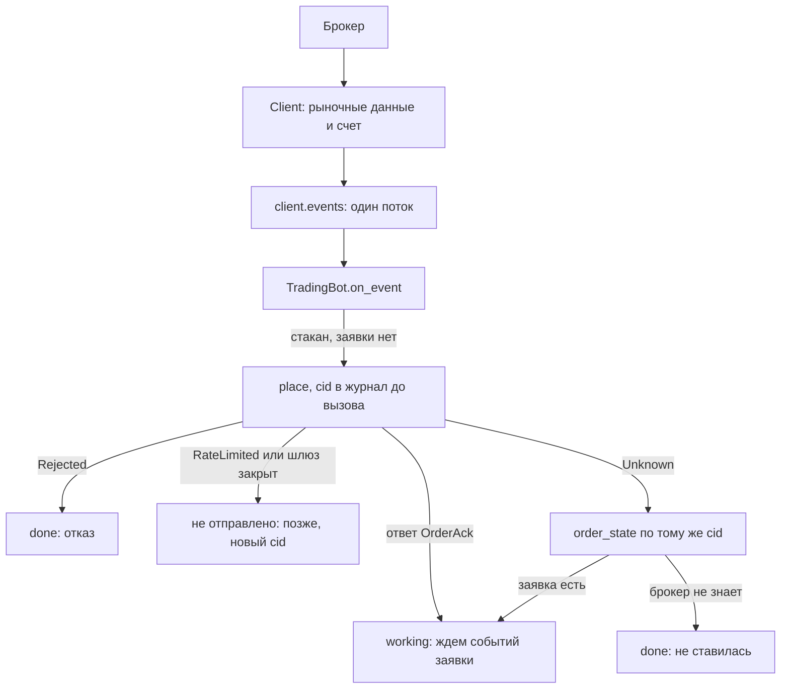

# Как написать торгового бота на событиях (Python)

Инструкция. Цель: бот, который читает стакан, по сигналу ставит заявку, следит за ее статусами, выходит из неясного исхода
(`Unknown`) и аккуратно останавливается. Правила, на которых он стоит, собраны в [Контракте для агентов](../agent-contract.md),
причины - в [Круге команд](../orders.md) и [Круге жизни](../reconcile.md). Код ниже - куски программы `trading_bot.py`, весь ее
текст в конце страницы. Она запускается тестом против имитации БКС, поэтому текст и проверенный код не расходятся.

Стратегия в примере заглушка: когда пришел стакан и своей заявки нет, купить минимальное количество на 1% ниже лучшей цены покупки.
Все остальное (журнал, сверка, исходы каждой команды, `Resync`, `Overflow`, `Reconnected`, остановка) нужно любому настоящему боту.

## Что получится

Один клиент, один поток событий и один цикл. Бот решает по событию, а исходы `place` разбирает на месте.



Из схемы следует: ответ на `place` и статусы приходят разными путями (результат вызова и события), `Unknown` разбирается запросом,
а не повтором, и каждая развилка заканчивается записью в журнал.

## Журнал

Журнал - память бота. Библиотека не пишет на диск ничего. Каждое изменение записывается в файл и сбрасывается на диск **до**
вызова, которому оно нужно: журнал, записанный после `place`, теряет заявку, которую оборвал сбой между отправкой и записью.
Последняя строка по `cid` главная. Битая последняя строка (сбой посреди записи) пропускается.

```python
{{#include ../../../crates/python/examples/trading_bot.py:journal}}
```

## Старт бота и события

`start` делает все по порядку: подписка на статусы и исполнения, `reconcile` со списком из журнала, правила инструмента, подписка
на стакан. Пока `start` не вернулся, бот не торгует. Подписки идут **до** сверки: иначе событие между снимком сверки и подпиской
пропало бы.

```python
{{#include ../../../crates/python/examples/trading_bot.py:bot}}
```

Что видно в коде:

- `Resync` обнуляет сохраненный стакан, следующий снимок его заменит.
- `Overflow` бывает двух видов. Переполнилась подписка на стакан (ее `sub` известен боту): стакан объявляется недействительным и
  подписка оформляется заново. Переполнился поток своих заявок: нужна сверка, а торговля до нее закрыта (`Degraded`).
- `Reconnected` значит, что поток своих заявок или исполнений оборвался и открыт снова: за обрыв могли пройти события, а торговля
  закрыта (`Degraded`) до сверки. Бот дочитывает поток и сверяется (читает `active_orders`, `order_state`, `executions` с запасом
  раньше `gap_from`, зовет `reconcile`).
- Событие неизвестного типа (`UnknownEvent`) не ломает цикл. Оно может быть про потерю данных, как два предыдущих, поэтому бот
  на всякий случай сверяется.
- Состояние заявки берется из событий (`on_order`), а не из ответа на `place`: ответ значит «брокер принял».
- В поток статусов попадают **все** заявки счета, в том числе поставленные руками. Заявок, которых нет в журнале, бот не трогает
  ([Контракт, правило 11](../agent-contract.md#11-чужие-заявки-не-трогать)).
- Сколько исполнено, бот берет из поля `filled` снимков, а не складывает события `Execution`: после `Overflow` сверка сама
  вернет правильное число.

## Сигнал и заявка со всеми исходами

```python
{{#include ../../../crates/python/examples/trading_bot.py:place}}
```

| Что случилось с `place` | Что значит | Что делает бот |
|---|---|---|
| вернул `OrderAck` | брокер принял, заявка стоит | запись `working`, ждет статусов |
| `Rejected` | брокер точно отказал, заявки нет | запись `done`, новая попытка только с новым `cid` |
| `NotReconciled`, `Degraded` | шлюз закрыт, ничего не ушло | пометка «сверить», запись `done: не отправлено` |
| `RateLimited` | квоты нет, ничего не ушло | пауза на `retry_after`, потом новый `cid` |
| `Unknown` | **неизвестно, дошла ли** | запись `unknown`, `order_state` по тому же `cid`, **не повторять** |

Цена считается `Decimal` и округляется вниз до шага (`round_to_step`): покупка не должна выйти за план, а цена должна лежать на
сетке брокера. Деньги и цены в боте нигде не проходят через `float`.

## Цикл и остановка

Поток событий читает одно место. Если бот делает долгую работу, он выносит ее в отдельную задачу и передает события своей очередью:
пока поток не читается, подписки без потерь копят события и при переполнении закрывают торговлю.

```python
{{#include ../../../crates/python/examples/trading_bot.py:loop}}
```

Остановка клиента **не снимает заявок на бирже**. Бот из примера не оставляет ни одной: он останавливается, когда его заявка
исполнена, а если вышел раньше, снимает ее сам.

## Вся программа

<details>
<summary>Текст программы crates/python/examples/trading_bot.py</summary>

```python
{{#include ../../../crates/python/examples/trading_bot.py}}
```

</details>

## Как проверить

```bash
cd crates/python
pytest tests/test_examples.py -k trading_bot
```

Тесты проверяют: бот покупает один раз и останавливается, когда имитация исполнила заявку. Бот, у которого ответ на `place`
потерялся (`Unknown`), спрашивает `order_state` и не шлет заявку второй раз. Отказ и закрытый шлюз разбираются по таблице выше.
Неизвестное событие включает сверку.

