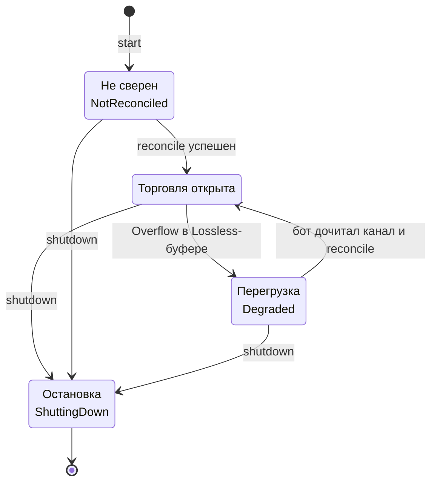
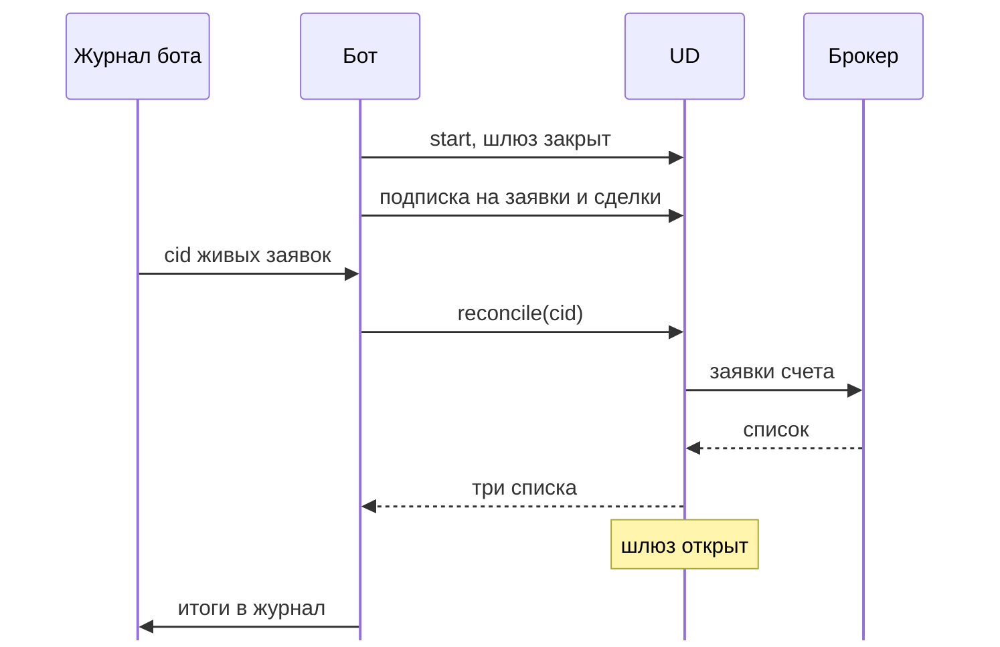

# Круг жизни: шлюз и сверка

После запуска библиотека не знает, какие заявки у бота были раньше: она ничего не хранит на диске. А на счете
могут стоять заявки с прошлого запуска, заявки, которые исполнились, пока бот был выключен, и заявки, поставленные
руками. Сверка (`reconcile`) разбирает это и только после нее **открывается шлюз торговых команд**. Это третий круг
механики: он решает, можно ли сейчас торговать. Схема трех кругов вместе - на [Карте](architecture.md#три-круга).

## Шлюз команд

У каждого UD есть шлюз торговых команд (`CommandGate`). Чтение работает всегда: `order_state`, `active_orders`,
`executions`, `portfolio`, подписки. Закрывается только торговля: `place`, `cancel`, `replace`, `place_stop`,
`cancel_stop` возвращают ошибку и в сеть не уходят. На схеме: состояния шлюза и переходы между ними.

Шлюз закрыт в трех случаях, и у каждого своя причина:

- **`NotReconciled`: после запуска.** Пока бот не знает, какие заявки уже стоят у брокера, новая команда может
  задвоить заявку или спорить с той, которую бот не видит.
- **`Degraded`: переполнился буфер подписки без потерь.** События о своих заявках могли пропасть, и локальная картина
  заявок с дырой. Торговать при дыре нельзя ([Круг событий](streams.md#переполнение-overflow-и-degraded)).
- **`ShuttingDown`: идет остановка.** Выхода нет, коннектор закрывается ([Запуск, рестарт и остановка](lifecycle.md)).

Если закрыто несколько условий одновременно, первым проверяется `ShuttingDown`, затем `Degraded`, затем
`NotReconciled`. Успешная сверка снимает `NotReconciled` и `Degraded`. Из обоих закрытых состояний выход один -
сверка. Что делает каждая ошибка шлюза и как из нее выйти: [Ошибки и что с ними делать](errors.md).

## Что бот передает и что получает

Бот передает **список `cid`** заявок, которые он считает живыми (открытыми или с неизвестным исходом). Получает
`ReconcileReport` с тремя списками:

| Список | Что в нем | Что делать |
|---|---|---|
| `confirmed` | заявки, которые есть и у бота, и у брокера. Пришли целиком (`OrderSnapshot`): состояние, исполнено, цена | Продолжать вести. Обновить в журнале состояние и исполненный объем |
| `closed_offline` | `cid` из вашего списка, которых нет среди живых у брокера: заявка исполнилась, снята, отклонена или так и не была принята, пока бот был выключен | Выяснить итог: `order_state(cid)` и история `executions(...)`. Занести итог в журнал |
| `foreign` | заявки, которые есть у брокера, но нет в вашем списке: поставлены руками, из приложения или другим роботом | **Не трогать.** Не снимать и не менять. Решение, что с ними делать, принимает человек |

У чужих заявок `cid` подставной: брокер вашего номера не знает. Он стабильный (один и тот же для одной заявки) и
выглядит как UUID, но выдан библиотекой из номера брокера, а не вами. Почему `foreign` нельзя трогать: бот не
знает, зачем человек поставил эту заявку, и снятие может сломать чужую стратегию или защитный стоп.

Порядок на схеме такой: бот поднимает UD (шлюз закрыт), подписывается на статусы, берет из журнала `cid` живых
заявок, зовет `reconcile`, получает три списка, шлюз открывается, итоги идут в журнал.

Если `reconcile` вернул ошибку (нет связи, лимит), он **не открыл шлюз**: подождите и вызовите еще раз. Ошибка при
этом ничего не говорит о заявках, сверка просто не состоялась. Пока шлюз закрыт, ставить заявки нельзя, и это
правильно: бот все еще не знает, что стоит на счете.

## Почему порядок именно такой

Пошаговая инструкция - на странице [Запуск, рестарт и остановка бота](lifecycle.md). Здесь причины:

- **Подписка идет до сверки.** Сверка делает снимок счета в одно мгновение. Событие, которое пришло между снимком
  и подпиской, иначе было бы потеряно: в снимке его еще нет, а подписка его уже не получит. Подписки при закрытом
  шлюзе разрешены именно поэтому.
- **Список `cid` берется из журнала бота.** Только бот знает, какие заявки он считал живыми. Библиотека не пишет
  на диск, и без этого списка она не отличит ваши заявки от чужих.
- **`reconcile` только читает**, поэтому его можно вызывать в любой момент и сколько угодно раз. Он не снимает и не
  меняет заявок. Единственное, что он меняет, - состояние шлюза.
- **Сверка не открывает шлюз при ошибке.** Если часть списка не прочиталась, результат нельзя считать полным.

## Как сверка устроена у брокеров

| Брокер | Как | Нюансы |
|---|---|---|
| Т-Банк | один запрос списка живых заявок счета. `cid` из вашего списка, которого среди живых нет, идет в `closed_offline` | в списке нет заявок, закрытых за время обрыва, их находят через `order_state` и `executions` |
| БКС | по каждому `cid` запрос статуса. Если брокер не знает номер (`NOT_FOUND`), он идет в `closed_offline`. Затем читается список активных заявок | любая другая ошибка по одному из `cid` сразу прерывает всю сверку. Что настоящий БКС отвечает на неизвестный `cid` именно `NOT_FOUND`, **проверить на живом счете** |
| Финам | один запрос списка заявок счета, `cid` каждой заявки читается из ее комментария. Не найденный в списке `cid` и найденный, но не активный, идут в `closed_offline` | зависит от того, что Финам возвращает комментарий заявки без изменений и что отдает `GetOrders` для закрытых заявок (оба вопроса не проверены) |

Список БКС ограничен: в нем только заявки с 26 января 2026 года и не больше 1000 последних (ограничение документации
БКС).

## Стоп-заявки

Обычная сверка стоп-заявки **не показывает**: ни в `confirmed`, ни в `foreign`. `cid` стоп-заявок в ваш список для
`reconcile` класть не надо: они попадут в `closed_offline`, потому что среди обычных живых заявок их нет.
Для стопов после старта вызывайте `active_stop_orders()` (см. [Стоп-заявки](stop-orders.md)). У Т-Банка после
рестарта `cid` в этом списке пустой, снимать стоп можно только по номеру брокера.

## Что хранит бот, а что нет

| Что | Где хранится |
|---|---|
| Журнал заявок: `cid`, состояние, номер брокера, исполнено | **бот** |
| Какие заявки считались живыми на момент остановки | **бот** (из журнала) |
| Номера брокера стоп-заявок Т-Банка | **бот**, если нужна отмена после рестарта |
| Связь `cid` и номера брокера, состояние заявок текущего запуска | библиотека, **в памяти**, после остановки исчезает |
| Подписки | библиотека, в памяти. После рестарта бот подписывается заново |

Библиотека не ведет журнал на диске и не восстанавливает состояние сама. Она дает основу для этого: **полный
упорядоченный поток событий** (каждый переход состояния заявки - событие), `cid` в каждом событии заявки и сверку,
которая сравнивает список бота со счетом.

Когда звать `reconcile`, кроме старта (после `Overflow`, после долгого обрыва, при сомнении в журнале): [Если что-то
пошло не так](recovery.md).
