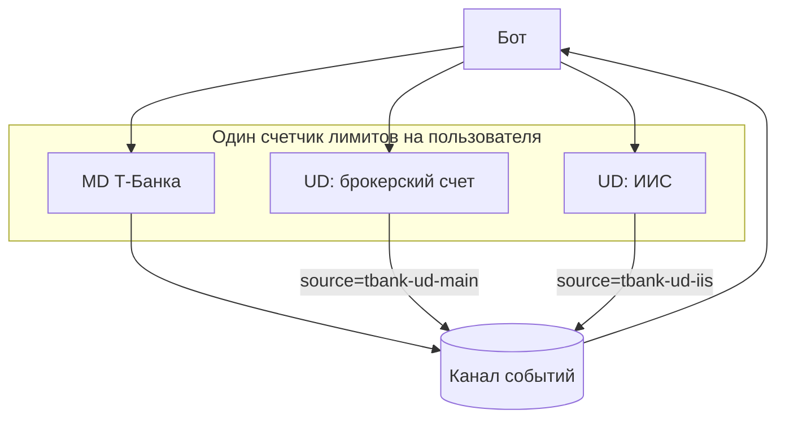
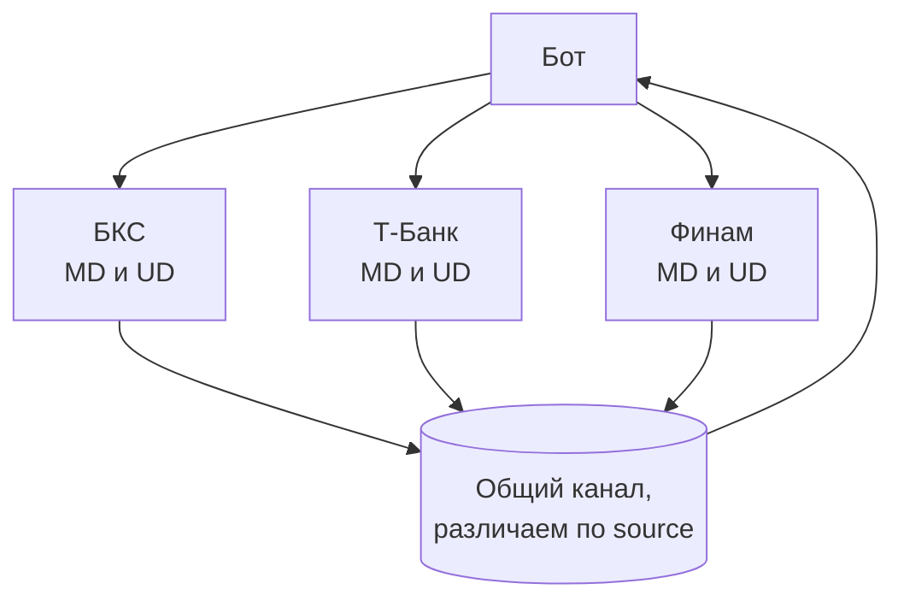

# Несколько счетов и брокеров

В одной программе можно держать любые сочетания: несколько брокеров, несколько счетов у одного брокера. Для этого
есть три простых правила.

> **UD на счет. MD на брокера. Один счетчик лимитов на область, в которой брокер считает лимит.**

- **UD (заявки, портфель) - по одному на каждый счет.** Один UD не умеет работать с двумя счетами.
- **MD (рынок) - один на брокера.** Рыночные данные от счета не зависят, второй MD ничего не добавит.
- **Счетчик лимитов (`BrokerLimiter`) - один на ту область, где брокер считает лимит**, и его получают все
  коннекторы, которые эту квоту тратят. Если дать им разные счетчики, вместе они превысят квоту и брокер начнет
  отказывать. Как устроен счетчик: [Лимиты запросов](../limits.md). Если дать один счетчик там, где лимиты независимы, они будут мешать друг другу без нужды.

Библиотека **не делает**: общий портфель по всем счетам и выбор, с какого счета ставить заявку. Это слой над
коннекторами, его пишет бот.

## Таблица по брокерам

| Брокер | Что задает счет | Где брокер считает лимиты | Счетчиков | Токены |
|---|---|---|---|---|
| БКС | **токен** (токен выдается на один счет), поэтому `account_id` нет | на токен (принято, не подтверждено вживую) | по одному на каждый счет, то есть на каждый токен | свой refresh-токен на счет |
| Т-Банк | `account_id` в настройке, один токен может видеть несколько счетов | **на пользователя**: все счета и все токены вместе, общий потолок 50 запросов в секунду с одного адреса (по документации Т-Банка) | **один** на всю программу | один токен на все счета |
| Финам | `account_id` в настройке, один секрет видит свои счета | на пользователя (так следует из документации, **проверить вживую**) | **один** | один секрет и один JWT на все счета |

Почему так записано для Т-Банка: документация брокера говорит, что лимитная политика распространяется на все счета
пользователя, а общее число запросов по всем счетам и токенам в секунду не должно превышать 50.

Где записана область, там и менять: в файле `crates/<брокер>/limits.toml`.

## Метки `source`

У каждого UD своя метка, по ней в общем канале видно, с какого счета событие. Назовите метки так, чтобы по ним
можно было понять счет: `tbank-ud-main`, `tbank-ud-iis`. Библиотека метку не разбирает, она нужна только вам.

## Один брокер, несколько счетов



Пример на два счета Т-Банка. Один токен, два `account_id`, один счетчик, один MD, один канал:

```rust
use std::time::Duration;

use brokapi::core::{Envelope, Event, OrderExecutor};
use brokapi::runtime::BrokerLimiter;
use brokapi::tbank::limits::default_limits;
use brokapi::tbank::{MarketDataConfig, MarketDataConnector, UserDataConfig, UserDataConnector};
use brokapi::tbank::protocol::TbankConfig;
use tokio::sync::mpsc;

#[tokio::main]
async fn main() -> Result<(), Box<dyn std::error::Error>> {
    let cfg = TbankConfig::from_env()?; // один токен

    // Т-Банк считает лимит на пользователя: счетчик один на всех
    let limiter = BrokerLimiter::new(&default_limits());
    let (tx, mut events) = mpsc::channel::<Envelope>(4096);

    let md = MarketDataConnector::start(
        MarketDataConfig::new(cfg.clone(), "tbank-md"),
        limiter.clone(),
        tx.clone(),
    )
    .await?;

    // По одному UD на счет, у каждого своя метка
    let main_account = UserDataConnector::start(
        UserDataConfig::new(cfg.clone().with_account("ID_БРОКЕРСКОГО_СЧЕТА"), "tbank-ud-main"),
        limiter.clone(),
        tx.clone(),
    )
    .await?;
    let iis_account = UserDataConnector::start(
        UserDataConfig::new(cfg.with_account("ID_ИИС"), "tbank-ud-iis"),
        limiter,
        tx,
    )
    .await?;

    // Каждому счету своя сверка и свой журнал cid
    main_account.reconcile(&[]).await?;
    iis_account.reconcile(&[]).await?;
    main_account.subscribe_order_state().await?;
    iis_account.subscribe_order_state().await?;

    // Разбор общего канала: кто прислал, определяет source
    let _ = tokio::time::timeout(Duration::from_secs(30), async {
        while let Some(env) = events.recv().await {
            match (&*env.source, env.payload) {
                ("tbank-ud-main", Event::Order(o)) => println!("основной счет: {} {:?}", o.cid, o.state),
                ("tbank-ud-iis", Event::Order(o)) => println!("ИИС: {} {:?}", o.cid, o.state),
                ("tbank-md", Event::OrderBook(_)) => {} // рыночные данные - общие для обоих счетов
                _ => {}
            }
        }
    })
    .await;

    let stop = brokapi::core::ShutdownMode::Graceful { deadline: Duration::from_secs(5) };
    main_account.shutdown(stop).await;
    iis_account.shutdown(stop).await;
    md.shutdown(stop).await;
    Ok(())
}
```

Что видно в этом примере. Каждый UD видит только заявки своего счета: проверено на имитации, UD одного счета не
может прочитать или снять заявку другого. Сверка идет отдельно по каждому счету со своим списком `cid`. Заявка
одного счета в `confirmed` другого не окажется.

### Финам

Один секрет и один JWT на несколько счетов: создайте менеджер токенов один раз и отдайте всем коннекторам.

```rust,ignore
let tokens = api.shared_tokens().await?;      // один вызов авторизации
let api = api.with_tokens(tokens);
let a = UserDataConnector::start(UserDataConfig::new(api.clone(), "СЧЕТ_A", "finam-ud-a"), limiter.clone(), tx.clone()).await?;
let b = UserDataConnector::start(UserDataConfig::new(api.clone(), "СЧЕТ_B", "finam-ud-b"), limiter.clone(), tx.clone()).await?;
let md = MarketDataConnector::start(MarketDataConfig::new(api, "finam-md"), limiter, tx).await?;
```

При запуске UD проверяет, что счет принадлежит секрету (список счетов берется из данных токена).
Если счета нет в списке, `start` возвращает `Config`. Область лимитов Финама проверяется вживую: сравнить
метрики использования для двух секретов одного пользователя.

### БКС

Счет определяет токен, поэтому два счета - два refresh-токена и **два счетчика лимитов**. MD держим с одним из токенов,
и он делит счетчик с UD этого же токена.

```rust,ignore
let cfg_a = BcsConfig::new(token_a).with_write(true);
let cfg_b = BcsConfig::new(token_b).with_write(true);
let limiter_a = BrokerLimiter::new(&limits);
let limiter_b = BrokerLimiter::new(&limits);
let md   = MarketDataConnector::start(MarketDataConfig::new(cfg_a.clone(), "bcs-md"), limiter_a.clone(), tx.clone()).await?;
let ud_a = UserDataConnector::start(UserDataConfig::new(cfg_a, "bcs-ud-a"), limiter_a, tx.clone()).await?;
let ud_b = UserDataConnector::start(UserDataConfig::new(cfg_b, "bcs-ud-b"), limiter_b, tx).await?;
```

Два токена БКС с двумя независимыми счетчиками проверены на имитации: у каждого свои заявки, стопы, события и сверка.

## Несколько брокеров

Коннекторы разных брокеров ничего не знают друг о друге: у каждого свое соединение и свой счетчик. Канал событий
можно дать общий (тогда брокеров различают по `source`), можно каждому свой.



Для общего кода полезно, что все UD имеют один набор трейтов (`OrderExecutor`, `PortfolioSource`...). Функцию можно
написать один раз и вызывать для любого брокера, как это сделано в [Быстром старте](quickstart.md).

Различия, которые общий код должен учитывать сам:

- **Единицы количества.** Во всех трех `Qty` это штуки (единицы инструмента), Т-Банк переводит лоты сам. Размер лота в
  `TradingParams::lot_size`.
- **Замена заявки** есть не у всех (`caps().supports_replace`).
- **Идентификатор инструмента** у каждого брокера свой вид (`NativeId`): [Брокеры](../brokers/README.md).
