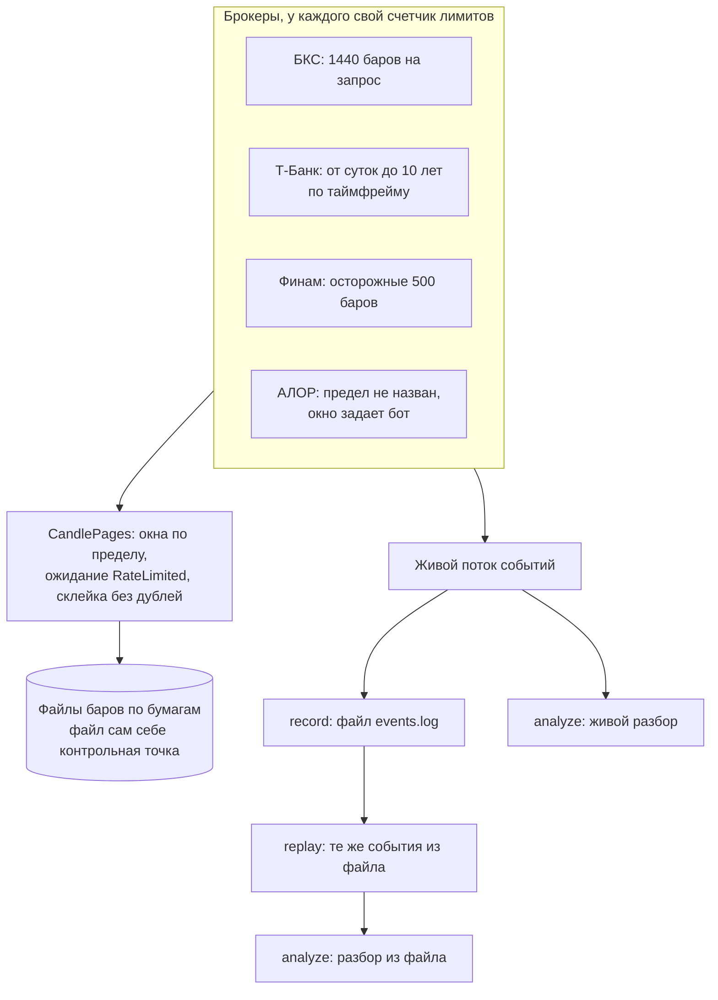

# Как собрать исследовательский движок

Инструкция. Цель: выгрузить длинную историю свечей и сделок по нескольким бумагам у нескольких брокеров, не нарушая лимитов,
записать поток событий в файл и проиграть его из файла столько раз, сколько нужно для разбора. Правила: [Контракт для
агентов](../agent-contract.md). Код ниже - куски программы `examples/research.rs`. Она запускается тестом против имитаций брокеров: имитации, как настоящие брокеры, отклоняют запрос длиннее предела и отдают ряд под заданный период.

## Что получится



Из схемы следует: история и живой поток независимы. Историю читают окнами по запросу, живой поток записывают как есть, и тот же
разбор (`analyze`) читает и живой канал, и проигрыш из файла, получая одно и то же.

## Подключение

```toml
[package]
name = "my-bot"
edition = "2024"   # нужен Rust 1.88 или новее: в коде книги цепочки let

[dependencies]
brokapi = { version = "{{brokapi_version}}", features = ["bcs", "tbank", "finam", "alor"] }
tokio   = { version = "1", features = ["full"] }
```

```rust,ignore
{{#include ../../../examples/research.rs:imports}}
```

## Как библиотека читает длинную историю

Один запрос свечей брокер принимает лишь в пределах: БКС не больше 1440 баров, Т-Банк по таблице (минутные бары за сутки,
пятиминутные за неделю, часовые за 3 месяца, дневные за 6 лет, недельные за 5, месячные за 10 лет), Финам и АЛОР предел не называют (у АЛОРа `candles_max_span` пуст, и без окна вся история уходит одним запросом: задайте `HistoryOpts::window`, если нужно резать).
Эти значения взяты из документации брокеров, их отдает метод `candles_max_span(таймфрейм)` коннектора.
`CandlePages` из `brokapi::runtime::history` пользуется им:

- режет период на окна не длиннее предела и читает их по порядку, по одному за вызов `next_page`,
- на `RateLimited` ждет `retry_after` (не дольше `max_rate_wait`, не больше `max_rate_waits` раз на окно),
- на сетевой сбой (`Transport`) читает окно еще раз с растущей паузой: чтение безопасно повторять, команды - нет,
- на любой другой отказ останавливается и возвращает `HistoryError` с местом, откуда продолжить (`resume_from`);
- склеивает окна без дублей: бар, который вернули оба соседних окна (брокеры по-разному считают конец периода), остается один раз.

Если коннектор не знает предел (`None`), период идет одним запросом. Размер окна можно задать самому: `HistoryOpts::window`.

`requests()` считает вызовы `candles`, в том числе те, что локальный счетчик отказал (до брокера они не дошли). Сколько запросов
реально ушло, считайте на стороне брокера (в тестах - счетчики имитаций). `rate_waits()` считает только ожидания внутри `CandlePages`.

Для данных на несколько тысяч баров есть `load_candles`: читает все в память одним вызовом.

## Файлы с барами

Один файл на бумагу: текст, строка на бар (`время, открытие, максимум, минимум, закрытие, объем`). Текст нарочно: его читает
любая программа, а начало файла остается правильным файлом. **Контрольной точкой служит сам файл:** где он кончается, там
продолжается выгрузка. Состояние не может разойтись с данными, потому что отдельного состояния нет.

```rust,ignore
{{#include ../../../examples/research.rs:files}}
```

## Выгрузка

Сначала вспомогательная `waiting`: **любое чтение тратит квоту, и `find`, и `last_trades`, и подписка, а не только свечи**, и любое может вернуть `RateLimited`.
`CandlePages` ждет сама, остальные чтения нет, их оборачивает `waiting`. Пример без нее ломается, как только бумаг больше, чем запас ведра (`burst`).

По брокерам выгрузка идет одновременно, по бумагам внутри брокера по очереди: у брокера один счетчик лимитов на все. Каждая
страница пишется одним `write_all` и сразу `sync_data`, и только потом просится следующая.

```rust,ignore
{{#include ../../../examples/research.rs:download}}
```

Что делает `download` с ошибками, по классу ошибки (`error.class()`):

| Класс | Примеры | Что делает движок |
|---|---|---|
| `Retryable` | `RateLimited` после всех ожиданий, `Transport` после повторов | ждет (`retry_after` или полсекунды) и продолжает бумагу **с места, где кончается ее файл**. До пяти попыток подряд без продвижения |
| `Fatal` | `Rejected`, `Config`, `Unsupported` | та же ошибка повторится: бумага попадает в `report.failed`, движок идет к следующей |

Что делает тест. Год часовых баров по двум бумагам у всех брокеров, ровно 8760 баров на бумагу без пропусков и дублей. Число
запросов к имитациям равно числу окон (БКС 7 на бумагу, Т-Банк 5, Финам 18, АЛОР 1: предел не назван). Счетчик лимитов в примере нарочно мал, поэтому
движок несколько раз ждет и не падает. Повторный запуск ничего не просит у брокеров.

## Сделки ленты

`last_trades(инструмент, число)` дает последние сделки ленты: сколько глубины, зависит от брокера (БКС: текущая сессия, Т-Банк:
последний час). Глубокой истории сделок в общем интерфейсе нет. Живую ленту записывайте потоком `subscribe_market_trades`
(режим `DropNewest` или `Lossless`, если терять сделки нельзя) в тот же журнал событий, что описан ниже.

## Запись потока событий в файл

`EnvelopeWriter` из `brokapi::runtime::record` пишет конверты в любой `Write`: строка JSON на конверт, перед ними строка-заголовок
с версией формата. Цены и количества записываются строками, поэтому возвращаются точно (`244.30` остается `244.30`).

```rust,ignore
{{#include ../../../examples/research.rs:record}}
```

Чего файл не хранит: монотонные часы `rx_mono`. После чтения в нем время чтения. Для порядка и замеров в проигрыше используйте
`rx_ts` и `broker_ts`.

## Проигрыш из файла

`replay` отправляет конверты в канал по порядку, как коннектор. Скорость: `ReplaySpeed::Instant` (насколько быстро читает
потребитель) или `Paced { factor, max_gap }` (темп записи, деленный на `factor`, пауза не длиннее `max_gap`).

**Отличие от живого потока.** Проигрыш ждет потребителя (`send().await`), поэтому медленный потребитель замедляет проигрыш и
ничего не теряется. Живой коннектор ждать не может и применяет режим подписки. Значит, проигрыш никогда не даст `Overflow`: код
разбора `Overflow` нужно проверять отдельно.

Файл в формате с более новой версией читать нельзя: `LogError::Schema`. Поврежденная строка останавливает чтение с номером
строки, пропустить ее молча нельзя.

## Разбор, один для живого потока и для файла

```rust,ignore
{{#include ../../../examples/research.rs:stats}}
```

Тест записывает 30 событий живого потока, проигрывает файл и проверяет, что число записанных равно числу проигранных и что
разбор вернул одно и то же.

## Вся программа целиком

<details>
<summary>Текст программы examples/research.rs</summary>

```rust,ignore
{{#include ../../../examples/research.rs}}
```

</details>

## Как проверить

```bash
cargo test --test examples research
cargo run --example research        # то же с выводом отчета по брокерам
```

## Сверка с NautilusTrader и пределы подхода

NautilusTrader хранит данные в каталоге Parquet с запросами по инструменту и времени и проигрывает их в бэктесте. В brokapi
взят самый простой вариант без зависимостей: текстовые файлы баров и журнал событий в JSON-строках.

| | NautilusTrader | brokapi |
|---|---|---|
| Формат | Parquet-каталог с индексом | текстовые файлы и журнал событий (строка JSON на конверт) |
| Запрос по инструменту и времени | есть | нет, фильтруйте при чтении |
| Проигрыш | движок бэктеста | `replay` в канал, потребитель - ваш код |
| Бэктест (исполнение, комиссии, позиции) | есть | нет, библиотека бэктест не делает |

Для лет данных и частых запросов берите каталог: тот же поток конвертов можно складывать в Parquet своим кодом, формат
`Envelope` стабилен (`schema`) и сериализуется через serde.

## Что менять под себя

- **Таймфрейм и период:** параметры `download`. `M10` у БКС не поддерживается (`Unsupported`).
- **Бумаги:** список в `Venue`. В боевом коде идентификаторы берутся из `find`.
- **Куда писать:** вместо файлов любая база. Условие то же: страница на диске до следующего запроса.
- **Лимиты:** `HistoryOpts` (`max_rate_waits`, `max_rate_wait`, `transport_retries`) и сами лимиты брокера
  (`limits_from_toml_path`, [Лимиты запросов](../limits.md#откуда-числа)).
