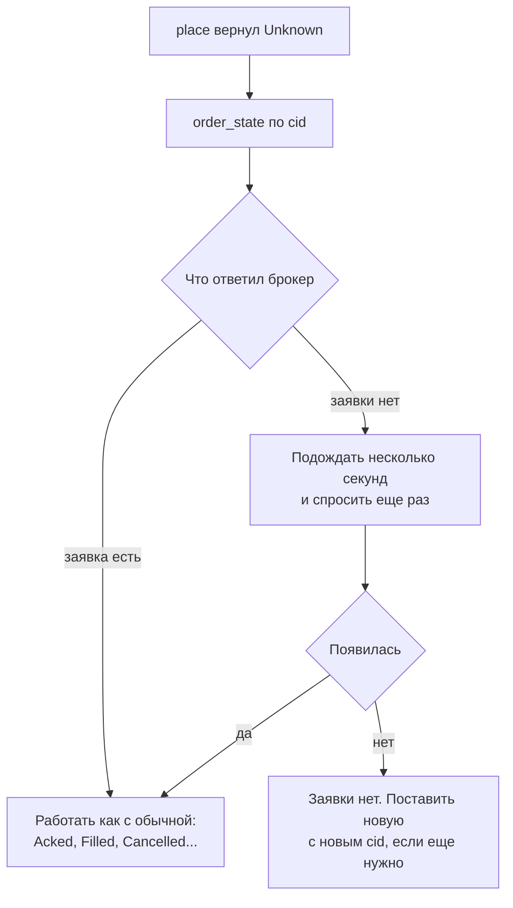

# Если что-то пошло не так

Инструкции на случаи, когда бот не знает, что со счетом: у заявки нет ответа, канал событий переполнился, пропала
связь. Что означает каждая ошибка и состояние, - на странице [Ошибки и что с ними делать](../errors.md), почему
библиотека устроена так - в [Круге команд](../orders.md) и [Круге жизни](../reconcile.md). Код - куски программы
`examples/recovery.rs`, она запускается тестом против имитации: `Unknown` там настоящий, получен таймаутом на
имитации Т-Банка.

## `place` вернул `Unknown`

Заявка ушла к брокеру, ответа нет. Она могла встать, могла не дойти. **Не повторяйте `place`:** если первая встала, на
счете окажутся две заявки. Вместо повтора спросите брокера по тому же `cid`.



На схеме: путь от `Unknown` до решения. Из нее следует: «заявки нет» сразу после обрыва не окончательно, запрос,
ушедший в сеть, мог дойти позже, поэтому один отрицательный ответ ничего не доказывает.

```rust,ignore
{{#include ../../../examples/recovery.rs:resolve_unknown}}
```

Вы должны увидеть: функция вернула `Some(заявка)`, если брокер ее знает, и `None`, если не знает и после ожидания. Как
это читается:

- **`order_state(cid)`** возвращает состояние заявки по вашему `cid`. Если брокер такой заявки не знает, вернется
  `Rejected` (код `not_found`, одинаковый у всех трех).
- Сколько времени брокер может держать запрос в пути, неизвестно (не проверено), поэтому ожидание ограничивайте
  своим временем, а не ждите бесконечно.
- Если в игру вступает сомнение (например, заявка могла исполниться и исчезнуть из активных), смотрите `executions` и
  `portfolio`.
- При следующем запуске бота `reconcile` вернет такую заявку как `confirmed` или `closed_offline`.
- Вторую заявку ставьте только когда убедились, что первой нет. Номер нужен новый: старый библиотека не отправит
  (`duplicate_place`).
- Для `cancel` с `Unknown` отмену **можно** повторить вручную после проверки `order_state`: повторная отмена новых
  заявок не создает. Для `replace` спрашивайте состояние по **обоим** номерам, исходному и новому.

## Пришел `Overflow` или ошибка `Degraded`

Буфер подписки без потерь переполнился: бот читал канал медленнее, чем шли события. Часть событий о своих заявках
могла пропасть, поэтому торговля закрыта, пока вы не сверитесь со счетом. Что делать, по порядку:

1. Дочитать канал событий до пустого. То, что дошло, обработайте до сверки: это события до дыры.
2. Вызвать `reconcile(&журнал)`. Успех снимает `Degraded`, подписки снова принимают события.
3. Восстановить пропущенное из снимков: состояние заявок из `confirmed` и `order_state`, сделки из `executions(...)` с
   момента `lost_from` из `Overflow`, портфель из `portfolio()`.
4. Вернуться к работе.

```rust,ignore
{{#include ../../../examples/recovery.rs:after_overflow}}
```

Вы должны увидеть: функция вернула отчет сверки, а следующий `place` перестал отвечать `Degraded`. Если `reconcile`
вернул ошибку, шлюз остался закрытым, повторите позже. Для **рыночных** подписок сверки нет, поэтому после `Overflow`
такую подписку снимают (`unsubscribe`) и оформляют заново. Чтобы переполнения не было: читайте канал отдельной задачей и
не делайте в ней долгих операций, размер буфера подбирайте с запасом на всплеск
([Круг событий](../streams.md#переполнение-overflow-и-degraded)).

## Поток заявок оборвался

Соединения коннектор восстанавливает сам, а бот узнает об обрыве потока заявок или потока исполнений по событию
`Event::Reconnected { sub, gap_from }`. Оно приходит, когда поток снова открыт, а за время обрыва могли пройти события, которых
бот не видел: заявка исполнилась, снялась, была отклонена. Это то же состояние, что после `Overflow`: шлюз закрыт
(`Degraded`), команды в сеть не уходят.

1. Дочитайте канал до конца. События до дыры нужны как обычно.
2. Прочитайте состояние у брокера: `active_orders()`, `order_state(cid)` по своим заявкам в пути, `executions(range)`, где
   `range` начинается с запасом раньше `gap_from`.
3. Вызовите `reconcile(&журнал)`. Успешная сверка открывает шлюз, следующий `place` проходит.

```rust,ignore
if let Event::Reconnected { sub, gap_from } = &env.payload {
    // 1. the events before the hole were handled as always
    // 2. read what the broker has: orders and fills since a little before `gap_from`
    let live = ud.active_orders().await?;
    let since = TimeRange::new(UnixNanos::from_nanos(gap_from.as_nanos() - 60_000_000_000), UnixNanos::from_nanos(i64::MAX / 2));
    let fills = ud.executions(since).await?;
    // 3. the gate opens
    ud.reconcile(&journal.live()).await?;
}
```

Если вы не слушаете события, а хотите узнать о закрытом шлюзе по ошибке, это `Error::Degraded` на команде, и действия те же.
Потеря связи без `Reconnected` (например, поток молчит, но не оборван) бывает, если сам брокер перестал присылать события.
Такое в коде не обнаруживается. Если связь была потеряна надолго или вы не уверены в журнале, зовите `reconcile`: он безопасен и
ничего не меняет на счете.

Что приходит сверх события, по брокерам: у Т-Банка коннектор сам перечитывает активные заявки и присылает изменившиеся, у БКС
и Финама нет. Поэтому после `Reconnected` читайте состояние сами, не ждите, что события наверстают.

## Другие случаи, когда звать `reconcile`

- **Не уверены в журнале.** Вызов только читает, его можно делать в любой момент и сколько угодно раз.
- **`NotReconciled` на команде.** После запуска не было успешной сверки: вызовите `reconcile`, потом повторите команду,
  `cid` годен ([Запуск, рестарт и остановка](lifecycle.md)).
- **Пришел `Resync`.** Это про стакан, а не про заявки: выбросьте хранимый стакан и дождитесь следующего снимка
  ([Круг событий](../streams.md#resync-стакан-мог-потерять-данные)).
