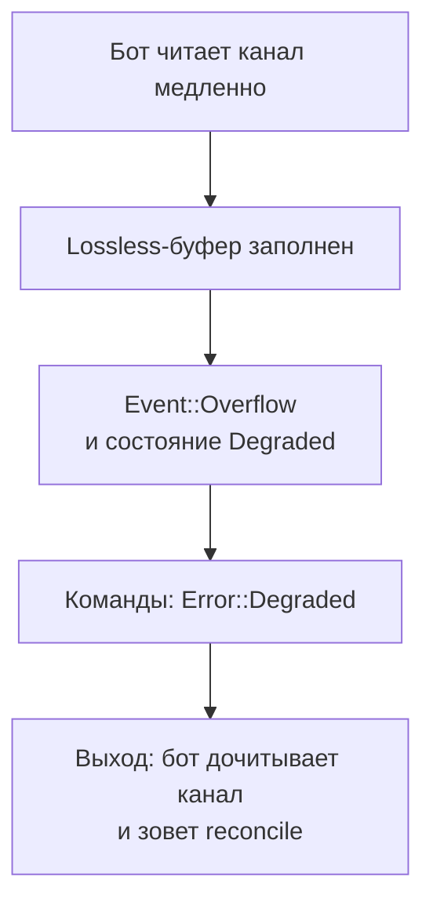
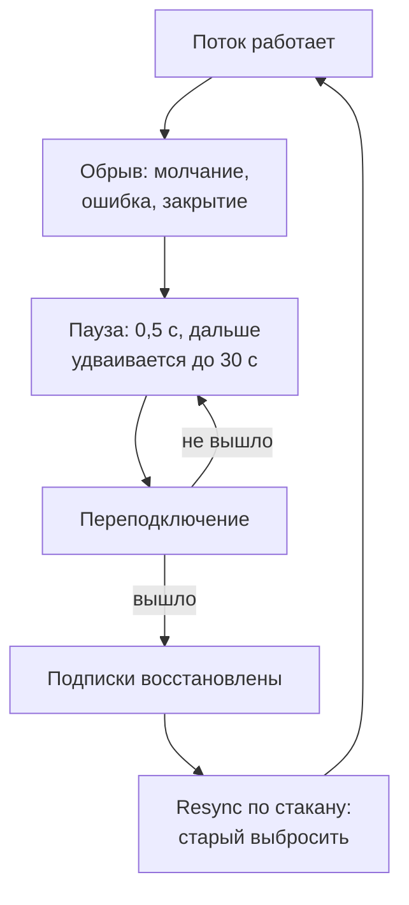

# Круг событий: подписки, буферы, обрывы

Страница описывает путь события от брокера к боту и то, что происходит, когда бот отстает или связь рвется. Схема
пути - на [Карте](architecture.md#круг-событий-брокер---бот), здесь ее подробности: подписки, режимы буфера,
переполнение, `Resync`, восстановление соединений и токены.

## Подписка

Метод `subscribe_*` (стакан, сделки, котировки, свечи, статусы заявок, исполнения, портфель) возвращает
`SubscriptionId`. События этой подписки приходят в общий канал в конверте с этим номером. Снять подписку можно
методом `unsubscribe(sub)` (для рыночных подписок).

Что важно:

- **Подтверждение.** У Т-Банка `subscribe_*` ждет подтверждения брокера не дольше `request_timeout`. Отказ - ошибка
  `Rejected`, нет ответа - `Transport`. У Финама ждет открытия потока `subscribe_ack_timeout` (3 секунды): отказ
  сервера возвращается ошибкой сразу, а если поток просто еще открывается, подписка возвращается и работает в фоне
  (состояние покажет `sub_status`). У БКС подписка отправляется сразу.
- **Повторная подписка.** У Т-Банка подписка на статусы заявок, исполнения и портфель одна на коннектор: повторный
  вызов вернет тот же `SubscriptionId`. Стакан и котировки одного инструмента идут одной проводной подпиской,
  отписка от одной не рвет другую.
- **Квота.** У Финама открытие потока тратит квоту, как любой запрос. Число одновременных потоков ограничено
  (`subscription_quota`).

## Режимы буфера

Между потоком брокера и общим каналом стоит **буфер на каждую подписку**. Поток брокера читается в любом случае
и никогда не ждет, пока бот разберет канал. Если бот отстает, события копятся в буфере подписки, а режим решает, что
с ними будет. Режим бот выбирает при подписке (`SubscribeOpts`).

| Режим | Что происходит, когда бот отстает | Для чего |
|---|---|---|
| `Conflate` | старый снимок заменяется новым, бот получает самый свежий. Данные не копятся | стакан, котировки (полные снимки) |
| `DropNewest { cap }` | пока в буфере меньше `cap` событий, все идет как обычно, при заполнении новые события отбрасываются, растет счетчик | некритичное: свечи, статистика |
| `Lossless { cap }` | ничего не теряется. Если буфер заполнился, это **переполнение**: см. ниже | свои заявки, свои сделки |

Для статусов своих заявок и исполнений годится **только `Lossless`**: библиотека сама ставит этот режим, размер
буфера задается в конфиге UD (`order_state_buffer`, по умолчанию 1024). Для портфеля режим выбирает бот.

Получается два простых правила:

- Стакан, котировки - `Conflate`. Старый снимок бесполезен, нужен последний.
- Все, что нельзя потерять, - `Lossless` с достаточным `cap` и **быстрое чтение канала** ботом.

## Переполнение: `Overflow` и `Degraded`

Если `Lossless`-буфер заполнился:

1. Коннектор присылает `Event::Overflow { sub, lost_from }`: этой подписке не хватило места, события начиная с
   `lost_from` могли быть потеряны. Событие приходит один раз на подписку, раньше обычных данных.
2. Новые события этой подписки отбрасываются, пока не будет сверки. Тихой потери нет: бот знает, что дыра
   образовалась.
3. Коннектор переходит в состояние **`Degraded`**: торговые команды возвращают `Error::Degraded`. Продолжать
   торговлю при дыре в данных о своих заявках нельзя.

На схеме: как медленное чтение канала доходит до закрытой торговли.

Почему торговля закрывается, а не продолжается с пометкой «возможна дыра»: бот видит свои заявки только по
событиям, и потерянное событие о частичном исполнении или снятии значит, что бот торгует по неверной картине.
Закрытый шлюз заставляет сначала сверить ее со счетом. Порядок действий боту: [Если что-то пошло не так](recovery.md#пришел-overflow-или-ошибка-degraded).

Чтобы переполнения не было: читайте канал отдельной задачей и не делайте в ней долгих операций. Размер буфера
подберите с запасом на всплеск.

У всех трех брокеров механизм одинаковый и проверен тестами на имитации брокера. Буферы подписок у Т-Банка и БКС - один и тот
же код (`Emitter` из `brokapi-runtime`), у Финама свой, с теми же правилами.

Для **рыночных** подписок сверки нет (сверка - это про заявки), поэтому после `Overflow` подписку нужно снять
(`unsubscribe`) и оформить заново. Для рыночных данных обычно хватает `Conflate`, и переполнения нет.

## `Resync`: стакан мог потерять данные

Стакан у всех трех брокеров приходит **полным снимком**, не приращениями. Поэтому следующий снимок сам заменяет
прежний. Но бывает, что прежнему верить уже нельзя. Тогда приходит `Event::Resync { sub, instrument, reason }`.

Когда:

| Причина | Когда | Брокер |
|---|---|---|
| `SubscriptionReset` | поток переоткрыт после обрыва, подписка пересоздана | Т-Банк (стакан и котировки), БКС (стакан), Финам (стакан) |
| `SequenceGap` | в данных брокера обнаружен пропуск. Т-Банк помечает так стакан, который сам брокер счел несогласованным (такой стакан не публикуется). Финам помечает приращение без базового снимка и немедленно переоткрывает поток | Т-Банк, Финам |

У БКС `SequenceGap` не бывает: стакан приходит полным снимком, и сверять нечего. `SubscriptionReset` идет по одному разу на каждую
подписку на стакан, сразу после переподключения WebSocket и **до** снимков восстановленных подписок. Первое подключение
`Resync` не дает: терять нечего. Коннектор узнает о подключении от самой сессии WebSocket, отдельным служебным сообщением в
том же потоке, что и данные, поэтому `Resync` не может обогнать данные и не может опоздать за ними.

**Что делать:** выбросить стакан, который хранится у бота, не торговать по нему, дождаться следующего
`Event::OrderBook`. У Финама `Resync` идет вне очереди склейки. У Т-Банка и БКС он проходит через буфер подписки, и если бот сильно
отстает, его может заменить более свежий снимок (он тоже свежий, так что бот в любом случае получит актуальные данные).

## Восстановление соединений

Все три коннектора сами переоткрывают оборванные соединения и восстанавливают подписки. Бот ничего для этого не
делает. На схеме: что происходит после обрыва, пока поток снова не заработает.

Из схемы следует, что бот не видит обрыва как отдельного события: он видит только `Resync` по стакану, когда поток
вернулся. Стакан у всех трех приходит полным снимком, поэтому после `Resync` достаточно дождаться следующего. А вот
для заявок «связь вернулась» не приходит вообще, и после долгого обрыва бот сам зовет `reconcile`
([Если что-то пошло не так](recovery.md#после-долгого-обрыва-связи)). Параметры по брокерам:

| | Т-Банк | БКС | Финам |
|---|---|---|---|
| Пауза перед повтором | 0,5 с, удваивается до 30 с, сбрасывается после удачного открытия. Не настраивается | 0,5 с, удваивается до 30 с, сбрасывается, если соединение прожило 10 с. Настраивается: `reconnect_min` и `reconnect_max` в `MarketDataConfig` и `UserDataConfig` | 0,5 с, удваивается до 30 с, сбрасывается, если поток прожил 10 с. Не настраивается |
| Как замечает обрыв | молчание дольше трех интервалов пинга (по умолчанию 3 x 30 с) | пинг каждые 30 с, нет ответа 60 с - переподключение | ошибка потока, закрытие сервером |
| Подписки | восстанавливаются все | восстанавливаются все | поток каждой подписки открывается заново |
| `Resync` стакана | да | да | да |
| Заявки после обрыва | активные заявки перечитываются, изменения приходят событиями. Заявки, закрытые за время обрыва, находятся через `order_state` и `executions` | не перечитываются | не перечитываются |
| Статус подписки | нет | нет | `sub_status(sub)`: `Connecting`, `Active`, `Reconnecting`, `Failed`, `Erroring` |

**Почему паузы одинаковые.** Ни в коде, ни в документации брокеров нет причины для разных диапазонов: ни один брокер не
называет, как часто можно переподключаться. Поэтому у всех трех один диапазон. Начало в 0,5 с не бьет по серверу в
первую секунду обрыва, а потолок в 30 с не оставляет бота без данных дольше половины минуты. У БКС границы можно поменять в настройке
коннектора. Сколько подключений в секунду БКС терпит на самом деле, неизвестно, это вопрос на живой прогон. У Т-Банка и
Финама паузы пока зашиты в код.

Особенности:

- Финам: подписка, которую сервер отверг (нет прав, нет инструмента), помечается `Failed` и пробуется снова примерно раз
  в 30 секунд, на случай, если права появятся. `subscribe_*` вернет ошибку сразу, если отказ пришел при открытии.
- Т-Банк: поток с истекшим сроком жизни (ошибка 80005) обрабатывается как обычный обрыв. Как часто это бывает,
  не проверено.
- БКС: при отказе 403 при подключении токен обновляется принудительно.

## Токены и их обновление

| Брокер | Что дает вход | Как обновляется |
|---|---|---|
| БКС | refresh-токен из настройки. Из него коннектор получает токен доступа | Токен доступа берется при первом запросе. После ответа 401 он обновляется, и запрос повторяется один раз. При отказе 403 на WebSocket токен обновляется принудительно. Если Keycloak присылает новый refresh-токен, коннектор принимает его, но только **в памяти**: на диск он не пишется, после рестарта берется токен из настройки. Остается ли старый refresh-токен рабочим, не проверено |
| Т-Банк | токен. Он статичный, обновлять нечего | Если токен отвергнут, это ошибка настройки (`Config`) |
| Финам | секрет Trade API. По нему коннектор получает JWT | Срок жизни JWT читается из ответа брокера. Обновление идет **заранее** (за пятую часть срока, от 5 до 120 секунд, но не позже середины срока), не дожидаясь ошибки. Неудачное обновление повторяется с паузой от 1 до 30 секунд, старый токен пока работает. Ошибка `UNAUTHENTICATED` вызывает обновление сразу. Чтение после этого повторяется один раз, **команды не повторяются никогда** |

Один JWT Финама можно разделить между несколькими коннекторами одного секрета (`shared_tokens`): [Несколько
счетов и брокеров](accounts.md).

Симптомы, которые видит бот, и что с ними делать: [Ошибки и что с ними делать](errors.md).
